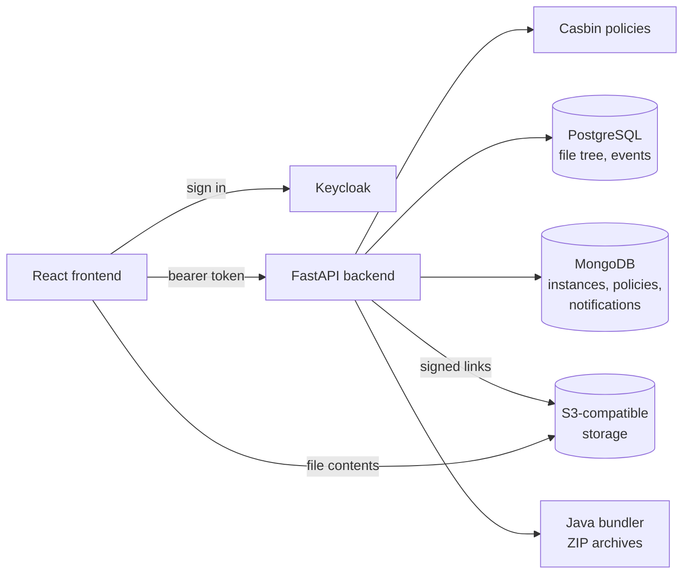

# INN Data Portal

A web portal for governing access to research data that stays on its owners' storage.

The INN Data Portal gives research teams one place to find, share and move data held across
institutional storage. The data stays where it is: the portal holds the access rules, the file
index and the identities, and grants short-lived, signed access to the storage itself. Each data
owner decides who may read, upload or delete what, down to a single file.

Developed by the Institute for Neuroscience and Neurotechnology (INN) and the Research Computing
Group (RCG) at Simon Fraser University.

## Features

- **Access by policy.** A permission names a file, or a folder and everything in it, including
  files added later, for one action: read, write, delete or administer. Users see only the folders
  and files they hold, separately for each action, and the backend checks every request.
- **Data stays on owner storage.** Files move directly between the browser and storage over signed,
  time-limited links; the portal never stores file contents. S3-compatible object storage is
  supported; POSIX file servers are in development.
- **Browse, search and transfer.** A searchable file tree per storage instance; uploads of files and
  whole folders; downloads of single files, or many files as one ZIP archive.
- **Projects and delegated administration.** Projects group people and storage. Project managers
  administer their own projects; administrators manage the whole portal.
- **Institutional sign-in.** Authentication through Keycloak (OpenID Connect), which can connect to
  an institution's existing identity provider.
- **Notifications.** Researchers are told when an upload is stored, in the portal and optionally by
  email; emails never name files.
- **Data standards.** Datasets that declare a standard, such as BIDS, are checked against it when
  files are uploaded.

## Getting started

Requirements: Git, and Docker with Compose v2.

```bash
cp local/.env.example local/.env
cd local
docker compose up -d --build
```

The [quickstart](docs/quickstart.md) covers the remaining setup (the MinIO host name, a first
storage instance), the services and their ports, and troubleshooting. The values in `.env.example`
are for local development only.

## Documentation

| For | Where |
|---|---|
| Researchers and administrators using the portal | [User guide](https://github.com/pmahon3/Data-Portal/wiki) (source: [`docs/user-guide/`](docs/user-guide/README.md)) |
| Running the portal locally | [Quickstart](docs/quickstart.md), [local development](local/README.md) |
| Developers | [Architecture diagrams](docs/diagrams/README.md), [frontend](docs/frontend/architecture.md), [API reference](docs/api-reference.md) |
| What the portal must do, and why | [How the documents fit](docs/README.md): the [strategy](docs/strategy/inn-digital-infrastructure-strategy-2026.md), [questions](docs/questions/use-cases.md), [requirements](docs/requirements/), [features](docs/features.md) and [designs](docs/design/README.md) |
| AI coding agents | [`AGENTS.md`](AGENTS.md) |

The running backend also serves its OpenAPI description at `/docs`.

## Architecture



The frontend signs users in with Keycloak and calls the backend with their token. The backend
decides each request with Casbin policies, keeps the searchable file tree in PostgreSQL, keeps
configuration, policies and notifications in MongoDB, and reaches storage through storage agents.
File contents go directly between the browser and storage; multi-file downloads are assembled by the
bundler. Details: [component architecture](docs/diagrams/component-architecture.md).

## Repository layout

| Path | Contents |
|---|---|
| `backend/` | FastAPI application: API routes (`api/`), services, storage agents and database access (`core/`), and the storage-event worker |
| `frontend/` | React application |
| `java-bundler/` | Spring Boot service that builds ZIP archives |
| `storage-gateway/` | File service for POSIX machines |
| `local/` | Docker Compose stack for local development |
| `deployment/` | Production Docker Compose and Nomad configuration |
| `tools/` | Object-storage notification setup and tests |
| `docs/` | User guide, strategy, questions, requirements, features, designs, diagrams, frontend and API docs ([how they fit](docs/README.md)); `docs/images/` holds the UI screenshots and the script that retakes them |

## Deployment

Production configuration is in [`deployment/`](deployment/). Before running the portal anywhere
shared:

- serve it over HTTPS;
- replace every default credential from `.env.example`, including the Keycloak administrator's;
- use a managed PostgreSQL for Keycloak;
- back up MongoDB (policies, instances) and PostgreSQL (file tree);
- collect logs centrally.

## Contributing

Branch from `development` and open a merge request back into `development`, one change per
request. Changes come with tests, and with documentation in the same branch: the user guide for
anything users see (see [Writing the user guide](docs/writing-the-user-guide.md)), `docs/` for
anything developers need. Requirements are in `docs/requirements/`;
cite the one a change implements.

Please report security issues privately to the maintainers rather than in a public issue.

## License

[Apache License 2.0](LICENSE).
