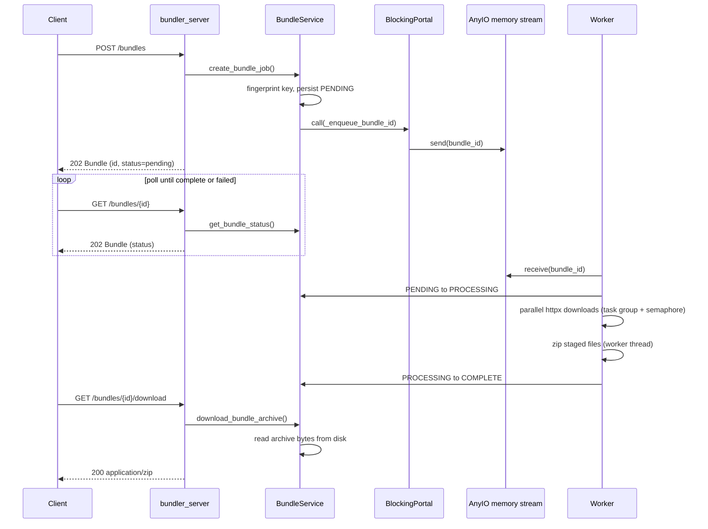
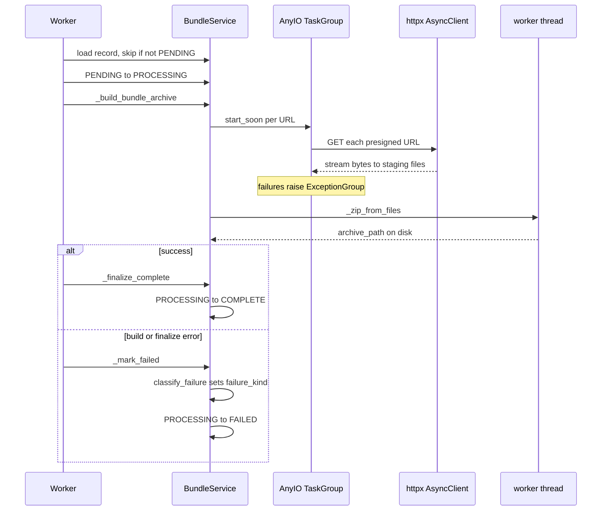
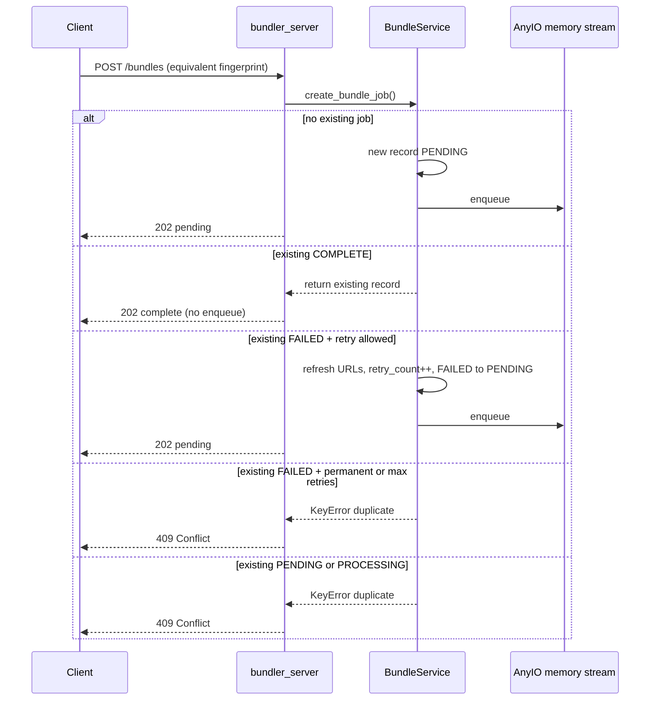
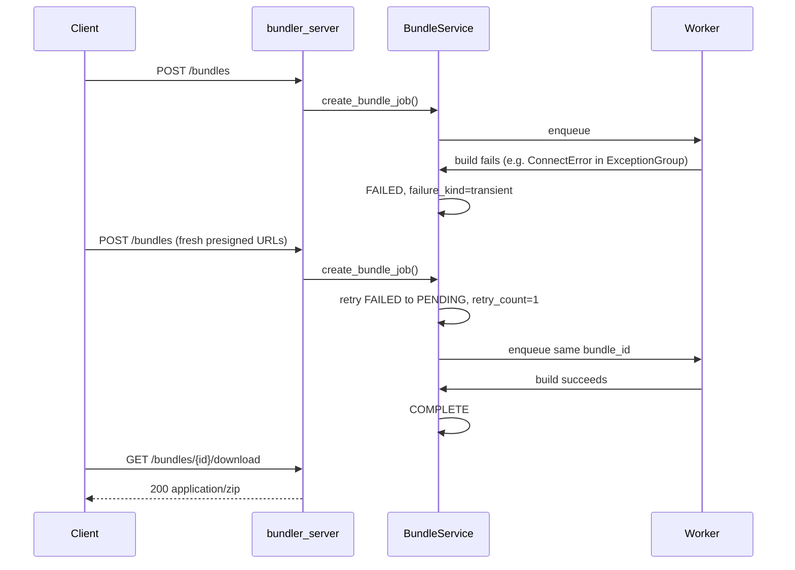

# Bundler Request Flow

> **Start here:** This doc is the **Bundle behavior** path (HTTP and worker sequences). To pick another goal, see [getting-started.md → Start here](../getting-started.md#start-here-what-to-read).

This document describes how a bundle request moves through the system from HTTP
acceptance to background processing and download. It complements
[`state-machine.md`](state-machine.md), which focuses on lifecycle states and
transitions.

Architecture: **Hexagonal (Ports & Adapters) + async job processing + explicit state machine**. For project layout and regeneration workflow, see [`README_dev.md`](README_dev.md) and [`README_reference.md`](README_reference.md).

## Layer Map

| Layer | Responsibility | Location |
|-------|----------------|----------|
| HTTP adapter | Map HTTP status codes and request/response models | `bundler/bundler_server/core/default_api_impl.py` |
| Domain service | Lifecycle, dedupe, queue, workers, download/zip | `bundler/bundler_core/src/bundles.py` (`BundleService`) |
| State machine | Allowed transitions and finalize/fail helpers | `bundler/bundler_core/src/models.py`, `state_ops.py` |
| Sync↔async bridge | Call async workers from sync entrypoints | AnyIO `BlockingPortal` (`_PortalRuntime`) |
| Worker queue | Producer–consumer job dispatch | AnyIO memory object streams |
| Idempotency | Normalized request fingerprint | `bundler/bundler_core/src/fingerprint.py` |

## Happy Path — Create, Poll, Download

Reliability path: **accept job → background work → poll → download**.

### Notes on the happy path

- `POST /bundles` returns quickly (**202**); zip work runs in the background.
- The HTTP adapter is `async def`, but domain entrypoints are synchronous; `BlockingPortal` bridges into the AnyIO worker runtime.
- Downloads stream to a per-job temp staging directory; zip creation runs in a thread (`anyio.to_thread.run_sync`) to avoid blocking the event loop.
- `GET .../download` currently reads the full ZIP into memory (`Path.read_bytes()`); true streaming is a known future improvement.

## Worker Internals

What happens inside `_process_bundle_job` after the worker dequeues a `bundle_id`:

## Create Dedupe and Retry Branches

Equivalent requests (same fingerprint; presigned query params ignored) branch on existing job status:

Retry policy: transient and unknown failures retry up to 3 times; permanent (403/404) failures do not. See [`state-machine.md`](state-machine.md#create-time-dedupe-post-bundles).

## Failure and Retry Loop

When a transient failure occurs, the backend typically regenerates fresh presigned URLs and the user re-initiates download (another `POST /bundles` with the same logical selection):

## Runtime Startup (first request)

The worker runtime starts lazily on first create:

1. `start_runtime()` opens an AnyIO memory stream and starts `BlockingPortal` in a background thread.
2. `_worker_supervisor` spawns `worker_count` consumer tasks (task group).
3. Each consumer loops: `receive(bundle_id)` → `_process_bundle_job(bundle_id)`.

Environment knobs: `BUNDLER_WORKER_COUNT`, `BUNDLER_DOWNLOAD_CONCURRENCY`, `BUNDLER_HTTP_TIMEOUT_SECONDS`, `BUNDLER_QUEUE_MAX_SIZE`.

## Related Documentation

- [`state-machine.md`](state-machine.md) — states, transitions, dedupe table, failure kinds
- [`README_dev.md`](README_dev.md) — quick start, tools, test layout
- [`../getting-started.md`](../getting-started.md) — orientation and doc map
- [`README_reference.md`](README_reference.md) — OpenAPI generation, Make variables, protected paths
