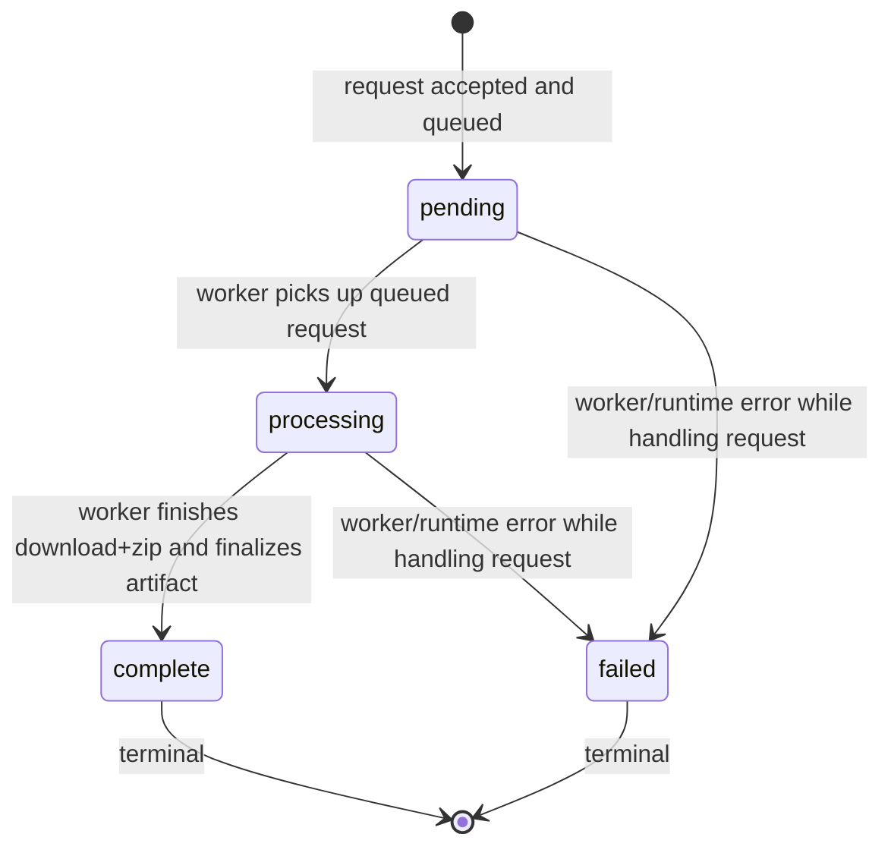

# Bundler State Machine

This diagram describes the lifecycle of a bundle request in `bundler/bundler_app`.
It applies to the core runtime flow where a request is accepted, queued, processed
by background worker(s), and later downloaded as an archive.

## Scope and Meaning

- `pending`: request has been validated, persisted in in-memory state, and queued.
- `processing`: a worker has claimed the request and started download/zip work.
- `complete`: archive metadata has been finalized; download is allowed.
- `failed`: processing encountered a runtime error; terminal error state.

## Where This Is Implemented

- State enum and transition rules:
  - `bundler/bundler_app/app/models.py` (`BundleState`, `can_transition`)
- Transition operations:
  - `bundler/bundler_app/app/state_ops.py` (`_transition_state`, `_finalize_complete`, `_mark_failed`)
- Runtime orchestration and worker loop:
  - `bundler/bundler_app/app/bundles.py` (`BundleService.create_bundle_job`, `_worker_consumer`, `_process_bundle_job`)

## Transition Notes

- Transition guard: all explicit transitions use `can_transition(...)` through
  `_transition_state(...)`.
- Allowed transitions are:
  - `pending -> processing`
  - `pending -> failed`
  - `processing -> complete`
  - `processing -> failed`
- `complete` and `failed` are terminal (no outgoing transitions by design).

## API-Level Context

- `POST /bundles`: creates a `pending` bundle and enqueues it.
- `GET /bundles/{bundleId}`: reports current lifecycle status.
- `GET /bundles/{bundleId}/download`: returns archive only when state is `complete`.

## Tests That Cover This Behavior

- `bundler/bundler_app/tests/test_bundles.py`
- `bundler/bundler_app/tests/test_bundle_zip_paths.py`

