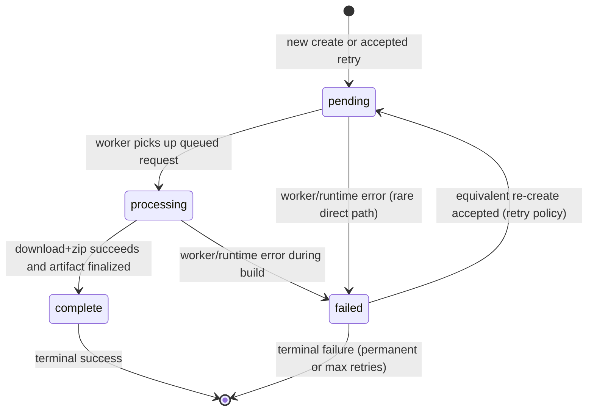

# Bundler State Machine

> **Start here:** This doc is the **Bundle behavior** path (states, dedupe, retry). To pick another goal, see [getting-started.md → Start here](../getting-started.md#start-here-what-to-read).

This diagram describes the lifecycle of a bundle request in `bundler/bundler_core`.
It applies to the core runtime flow where a request is accepted, queued, processed
by background worker(s), and later downloaded as an archive.

For the end-to-end HTTP and worker sequence, see [`bundle-request-flow.md`](bundle-request-flow.md).

## Scope and Meaning

- `pending`: request validated, persisted in in-memory state, and queued (or re-queued after retry).
- `processing`: a worker has claimed the request and started download/zip work.
- `complete`: archive metadata finalized; download is allowed. Terminal success state.
- `failed`: processing encountered an error. May return to `pending` when retry policy allows an equivalent re-create; otherwise terminal.

## Internal Record Fields (not all exposed via API)

| Field | Set when | Purpose |
|-------|----------|---------|
| `error_message` | `_mark_failed` | Last failure message (cleared on retry re-queue) |
| `failure_kind` | `_mark_failed` | `transient`, `permanent`, or `unknown` — drives retry eligibility |
| `retry_count` | `_retry_failed_bundle` | Number of accepted re-create retries after failure |
| `archive_path` | `_finalize_complete` | On-disk ZIP location for download |

## Where This Is Implemented

- State enum and transition rules:
  - `bundler/bundler_core/src/models.py` (`BundleState`, `can_transition`)
- Transition operations:
  - `bundler/bundler_core/src/state_ops.py` (`_transition_state`, `_finalize_complete`, `_mark_failed`, `_requeue_for_retry`)
- Failure classification:
  - `bundler/bundler_core/src/failures.py` (`FailureKind`, `classify_failure`)
- Runtime orchestration, create dedupe, and worker loop:
  - `bundler/bundler_core/src/bundles.py` (`BundleService.create_bundle_job`, `_retry_failed_bundle`, `_worker_consumer`, `_process_bundle_job`)

## Transition Notes

- Transition guard: all explicit transitions use `can_transition(...)` through `_transition_state(...)`.
- Allowed transitions:
  - `pending → processing`
  - `pending → failed`
  - `processing → complete`
  - `processing → failed`
  - `failed → pending` (retry re-queue only)
- `complete` has no outgoing transitions.
- `failed → processing` is **not** allowed (worker always enters via `pending`).

## Create-Time Dedupe (`POST /bundles`)

Fingerprint dedupe is evaluated in `create_bundle_job` **before** enqueue. Behavior depends on existing job status:

| Existing status | Equivalent re-create | Result |
|-----------------|----------------------|--------|
| *(none)* | first request | New record → `pending` → enqueue |
| `complete` | yes | Return existing record (**202**); no enqueue |
| `failed` + retry allowed | yes | Refresh URLs, increment `retry_count` → `pending` → enqueue |
| `failed` + permanent / max retries | yes | **409** duplicate conflict |
| `pending` / `processing` | yes | **409** duplicate conflict |

Retry eligibility (`failed` only): transient and unknown failures retry up to `MAX_BUNDLE_RETRIES` (3); permanent failures (403/404) do not retry.

## Failure Classification

When `_mark_failed` runs, `classify_failure(exc)` sets `failure_kind`:

| Kind | Typical causes |
|------|----------------|
| `transient` | `httpx` timeout/connect/network errors; HTTP 502/503/504 |
| `permanent` | HTTP 403/404 |
| `unknown` | Unclassified exceptions (e.g. `RuntimeError`) |

Parallel download failures from AnyIO task groups arrive as `ExceptionGroup`; the classifier unwraps nested exceptions and merges with priority **permanent > transient > unknown**.

## API-Level Context

- `POST /bundles`: creates or re-queues a `pending` bundle, returns idempotently for `complete`, or rejects duplicates while in-flight.
- `GET /bundles/{bundleId}`: reports current lifecycle status.
- `GET /bundles/{bundleId}/download`: returns archive only when state is `complete`.

## Tests That Cover This Behavior

- `bundler/bundler_core/tests/test_bundles.py` — create, dedupe, complete-state idempotency, download
- `bundler/bundler_core/tests/test_state_transitions.py` — worker transitions, illegal paths, `failed → pending` re-queue
- `bundler/bundler_core/tests/test_bundle_retry.py` — failed → pending retry orchestration
- `bundler/bundler_core/tests/test_failure_classification.py` — exception → policy kind mapping
- `bundler/bundler_core/tests/test_bundle_zip_paths.py` — archive path rules during build
