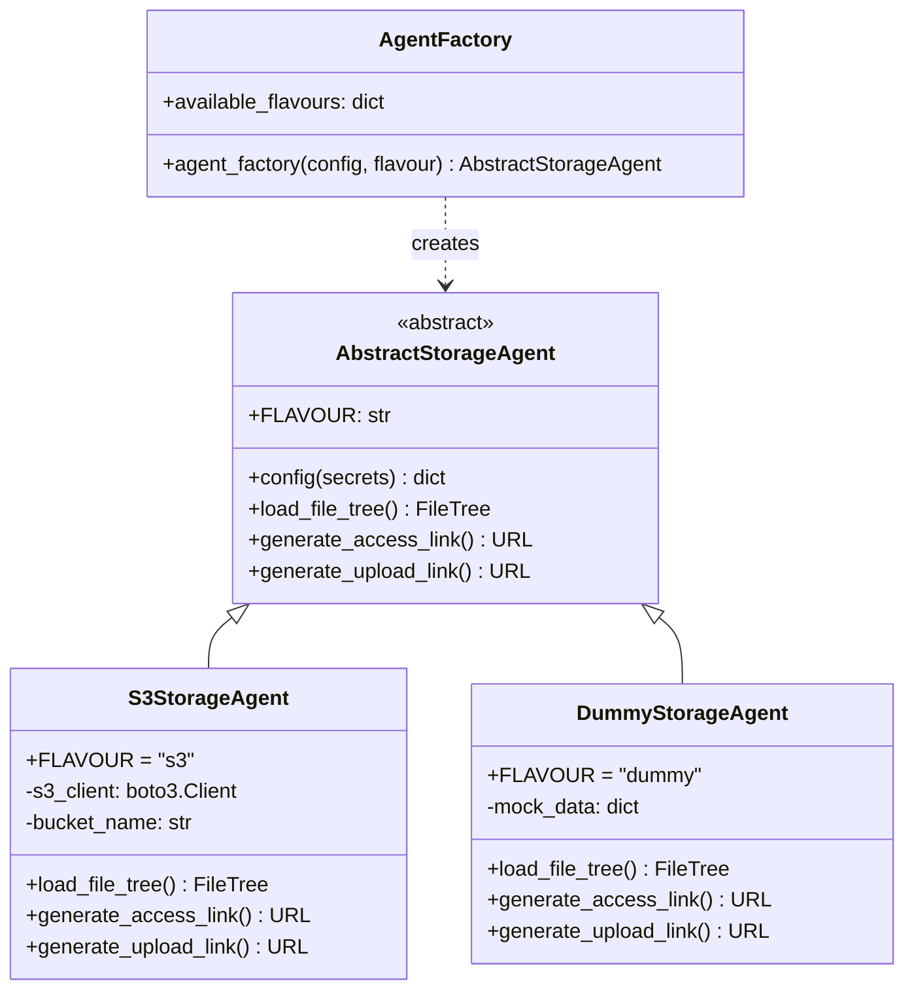
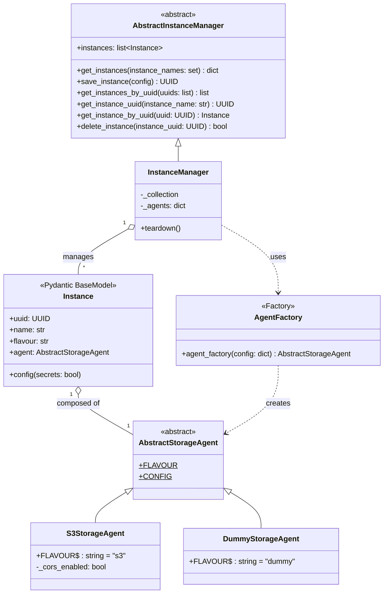
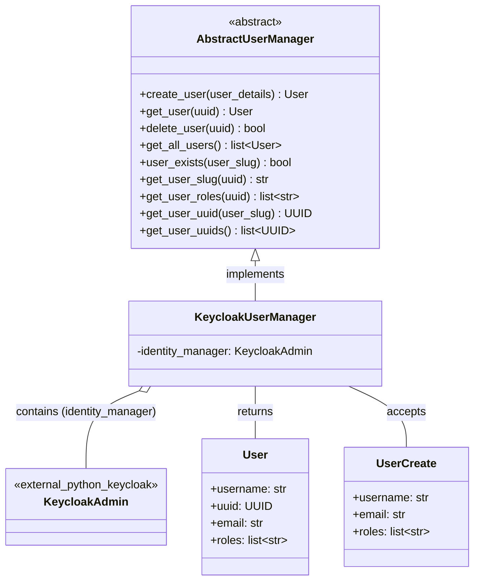
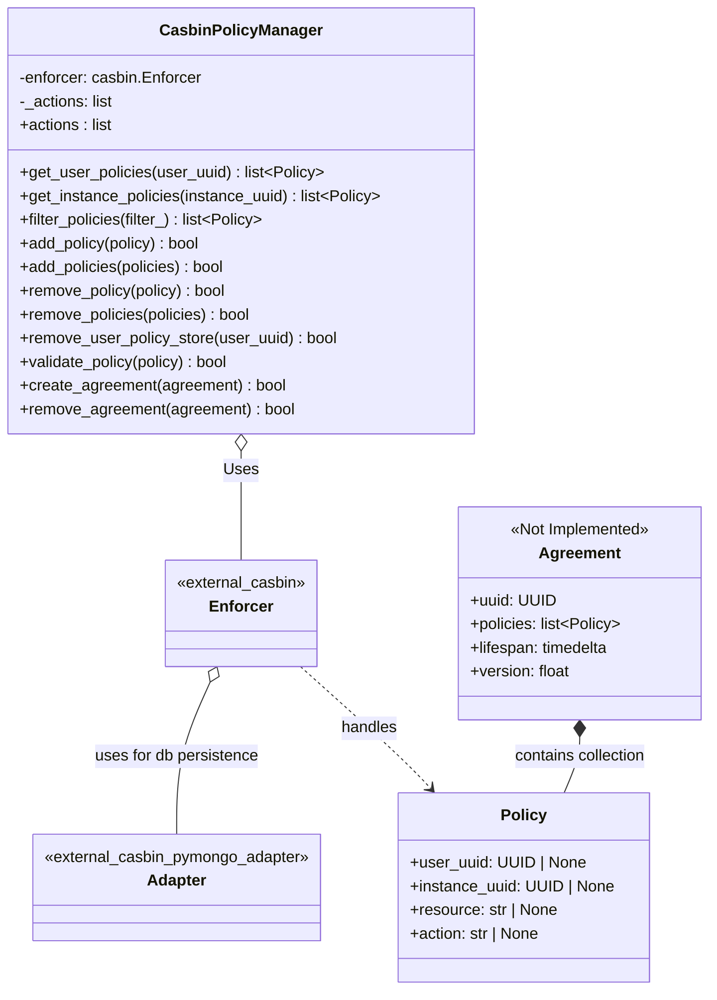
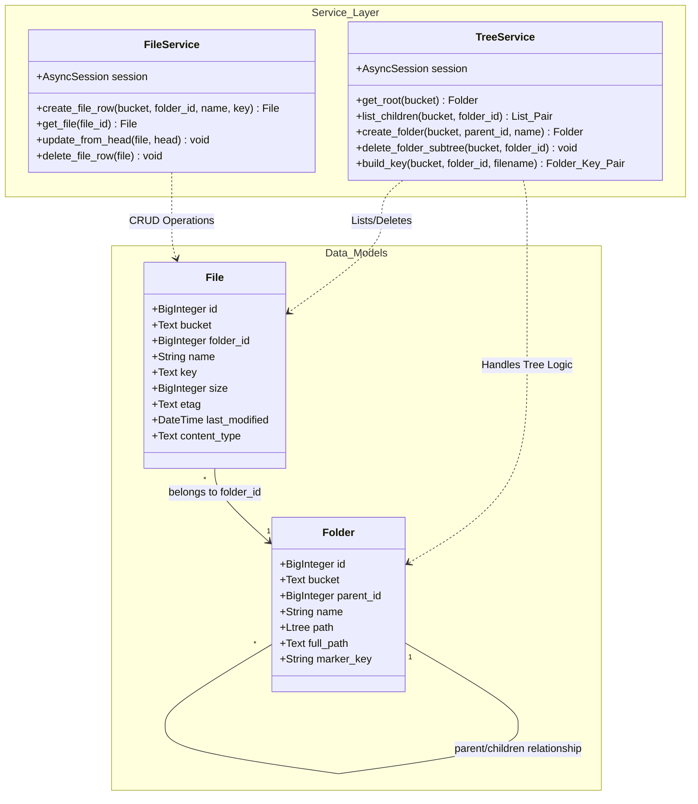

  # Class Services Diagrams

## Storage Agent Architecture

Pluggable storage backend system using the Abstract Factory pattern.

## Instance Manager Architecture

This service orchestrates the lifecycle of storage instances. 
It initializes connections via specialized agents during startup and provides a unified interface for CRUD operations.
Additionally, it maintains a registry of agents which handle instance-specific tasks, such as generating pre-signed URLs.

## User Manager Architecture

Provides a service layer for the CRUD lifecycle of users. 

## Policy Manager Architecture

Provides a service layer for the CRUD lifecycle of policies and agreements. 
Persistence is managed via a MongoDB Casbin adapter.
Note: Agreement functionality is currently defined but not yet implemented.

## Tree Service Architecture

