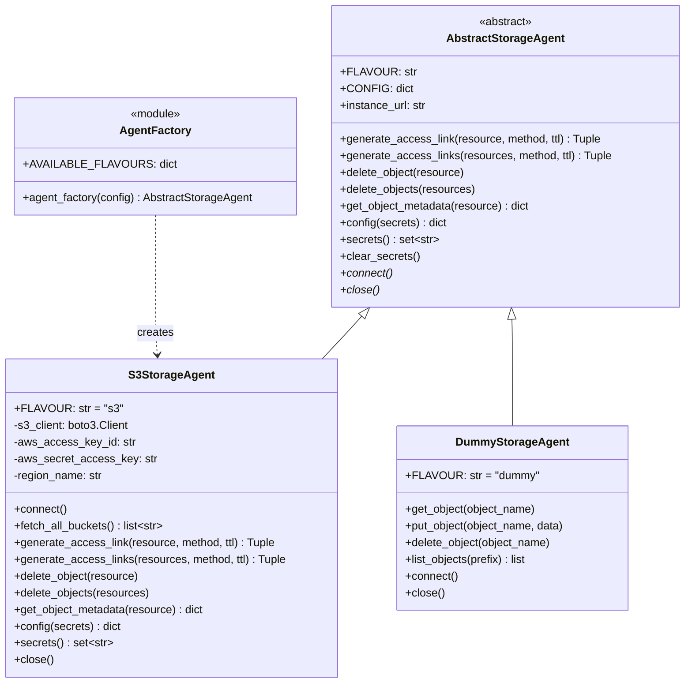
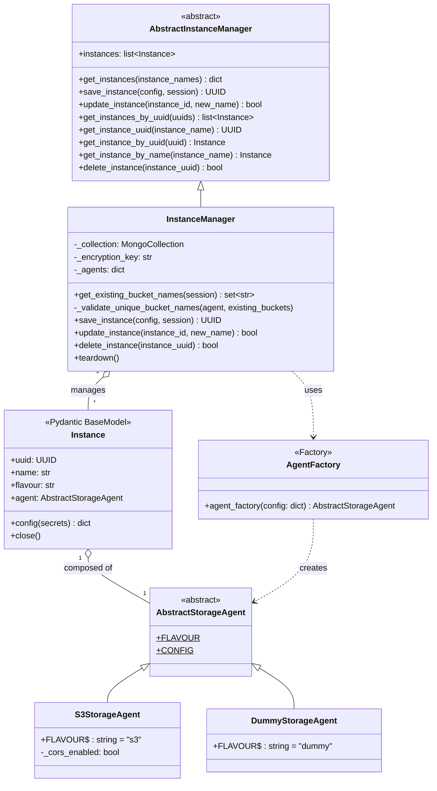
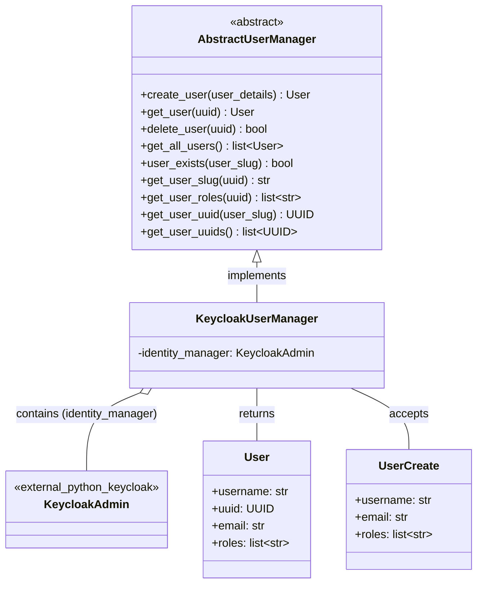
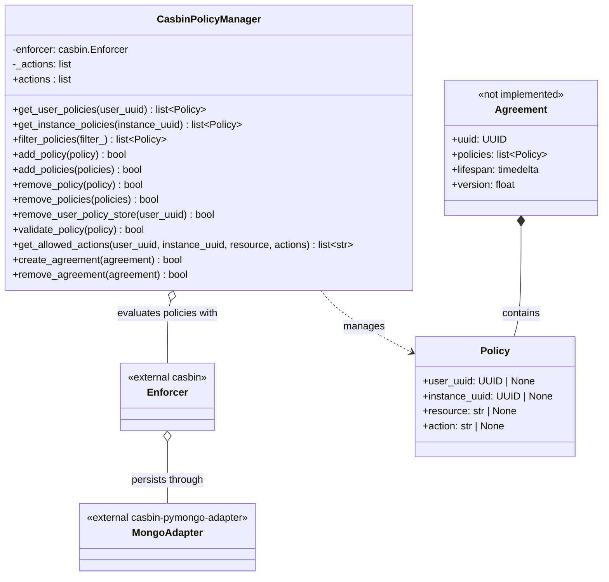
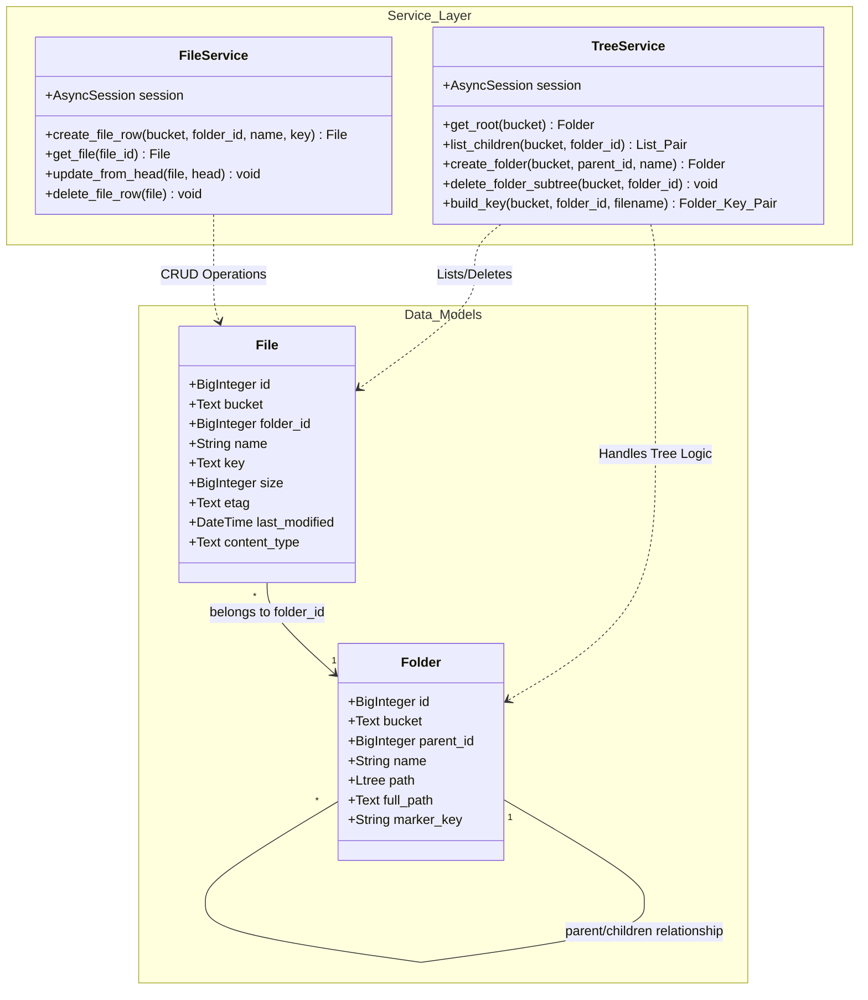

# Class Service Diagrams

**Last updated:** 2026-08-11

## Storage Agent Architecture

Pluggable storage backends are created by the storage-agent factory. Agents own
backend-specific connections and operations; file-tree metadata is no longer
cached by the agents.

## Instance Manager Architecture

The instance manager persists configuration in MongoDB and keeps connected
agents in memory. Secret fields declared by an agent are encrypted before
persistence and cleared from memory after connection. Bucket names already
represented in PostgreSQL are used to reject conflicting storage instances.

## User Manager Architecture

Provides a service layer for the CRUD lifecycle of users. 

## Policy Manager Architecture

Provides a service layer for the CRUD lifecycle of policies and agreements. 
Persistence is managed via a MongoDB Casbin adapter.
Note: Agreement functionality is currently defined but not yet implemented.

## Tree Service Architecture

