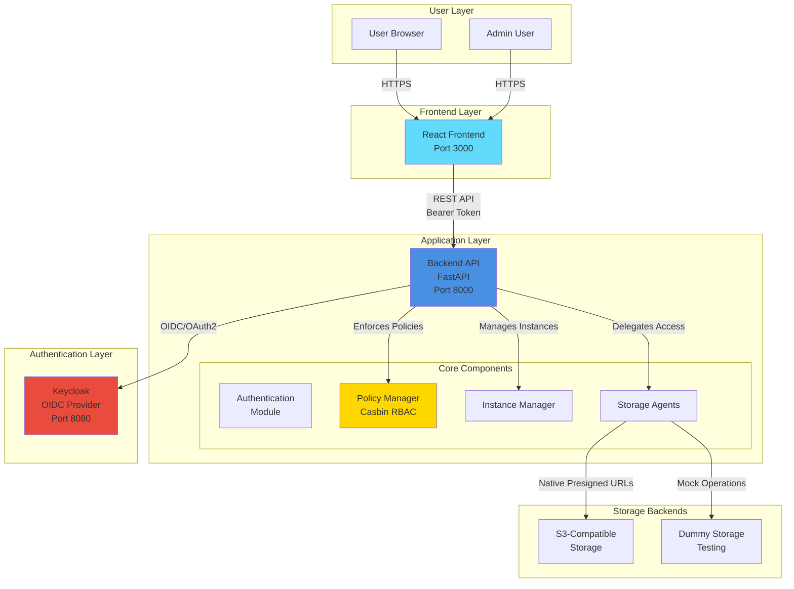
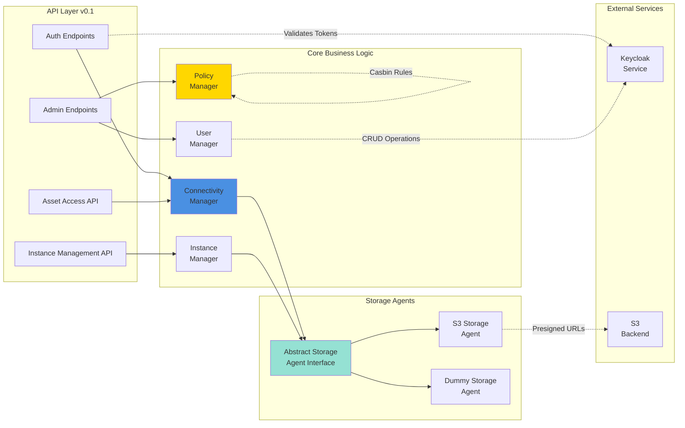
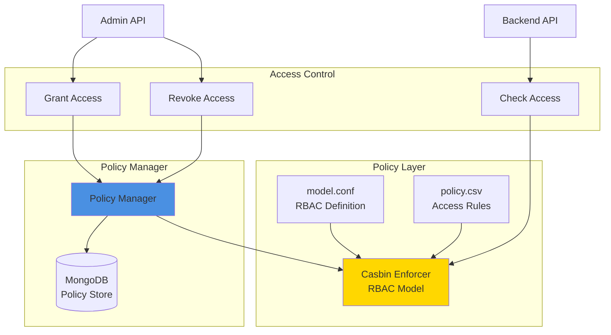
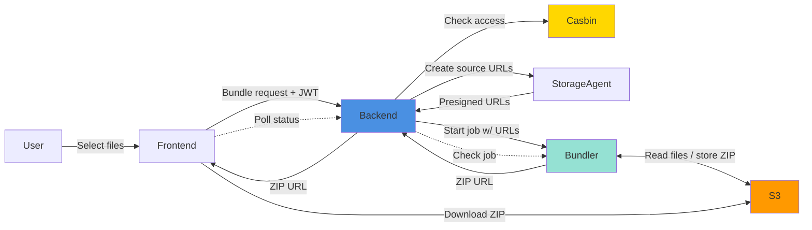

# Component Architecture

**Last updated:** 2026-08-12

## System Overview

High-level view of the AMS Data Portal components and their relationships.
The frontend communicates with the backend via REST APIs secured by Bearer tokens;
the backend delegates authentication to Keycloak and enforces access through
Casbin policies backed by a MongoDB adapter.

## Backend Core Components

Detailed view of the backend application structure.

## Policy Management Architecture

Casbin-based RBAC system with flexible policy enforcement.

## Data Flow

How multiple files are packaged and downloaded through the bundler.

---

## Component Responsibilities

### Frontend (React)
- User interface and interaction
- Authentication flow (OAuth2/OIDC)
- API communication with Bearer tokens
- File upload/download UI
- Admin dashboard

### Backend (FastAPI)
- REST API endpoints
- JWT token validation
- Policy enforcement via Casbin (MongoDB adapter)
- Storage agent coordination (factory pattern)
- User and instance management
- File-tree metadata service (PostgreSQL)

### Keycloak
- User authentication (OIDC)
- Token issuance (JWT)
- User management
- Role-based access control
- SSO support

### Storage Agents
- Abstract storage interface
- S3 presigned URL generation
- Secret encryption and lifecycle management
- Backend-specific operations

### Casbin Policy Engine
- RBAC policy enforcement
- Fine-grained access control
- Dynamic policy management
- Resource-level permissions
