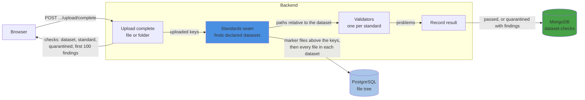

# Data Standards

**Last updated:** 2026-10-31

How uploaded data is checked against the standard it declares (STD-1). A folder declares a standard
by holding that standard's marker file at its root (BIDS: `dataset_description.json`), so data
placed on a machine directly declares it the same way. When an upload completes, every declared
dataset it touched is checked as a whole. A failure puts the dataset in quarantine and the upload's
response names what failed; a later pass takes it out.

Checks read names and layout from the file tree only, so no file contents move. Checks that need
the contents (sidecar files, image headers) will run beside the data on the storage machine.

Still open:
- **What quarantine holds back (N-QUARANTINE).** Until it's decided, quarantine is recorded and
  shown, and holds nothing back.
- **Which standards the portal checks (E-STD).** Each standard plugs in a validator.

| Setting | Meaning |
|---|---|
| `MONGO_DATASET_CHECK_COLLECTION` | Collection for results (default `dataset-checks`), one per dataset and standard |
