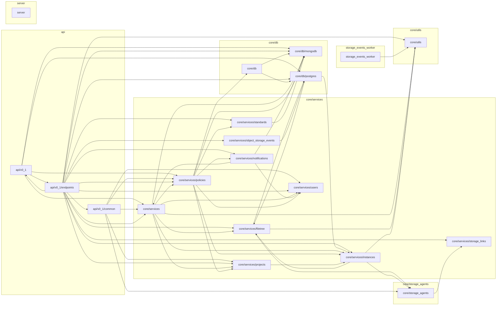

<!-- Generated by docs/diagrams/generate.py from the code. Don't edit: change the code, then run the generator. -->

# Backend packages

The backend's folders (at most three levels down, for example `core/services/policies`), boxed by layer. An arrow means code in one imports from the other.

## Packages

