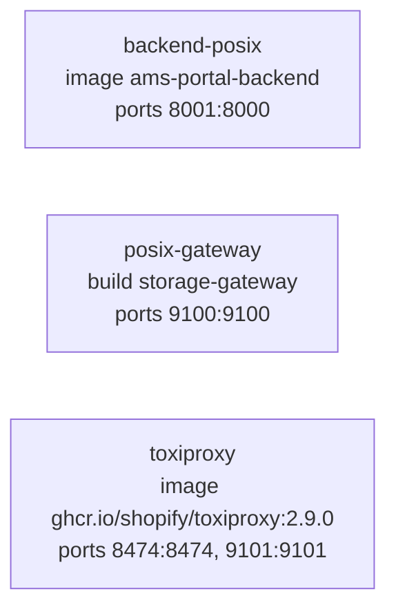
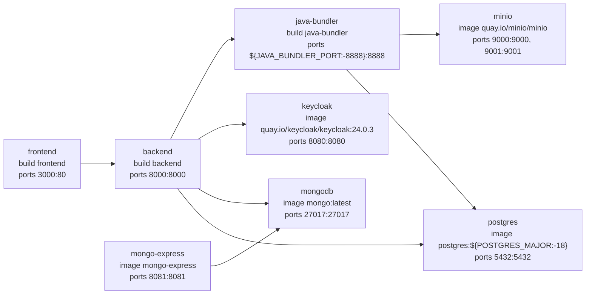
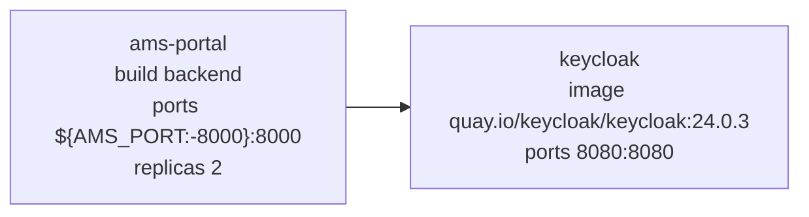
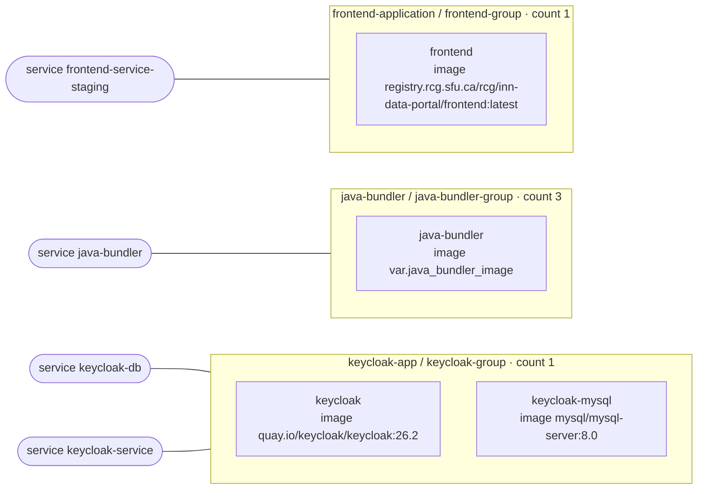

<!-- Generated by docs/diagrams/generate.py from the code. Don't edit: change the code, then run the generator. -->

# Deployment

Services in each Docker Compose file (with the files it includes; an arrow is `depends_on`), and the Nomad jobs: each group, how many run, its tasks and the services it registers.

## local/docker-compose.posix.yaml

## local/docker-compose.yaml

## deployment/docker-compose.yml with docker-compose.prod.yml

## Nomad jobs (deployment/*/*.nomad)

