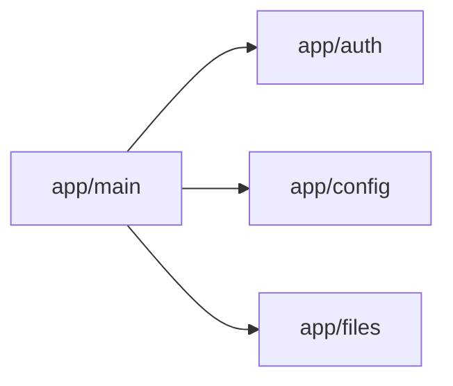

<!-- Generated by docs/diagrams/generate.py from the code. Don't edit: change the code, then run the generator. -->

# File service modules

The POSIX file service (`storage-gateway/`), module by module. An arrow means one imports the other.

## Modules

