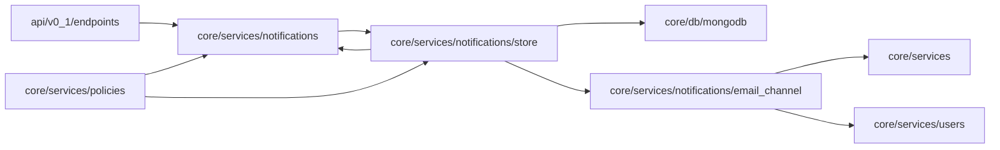

<!-- Generated by docs/diagrams/generate.py from the code. Don't edit: change the code, then run the generator. -->

# Notifications

The notifications package (`core/services/notifications`), what uses it and what it uses.

## Neighbourhood

