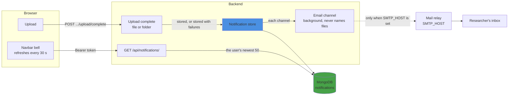
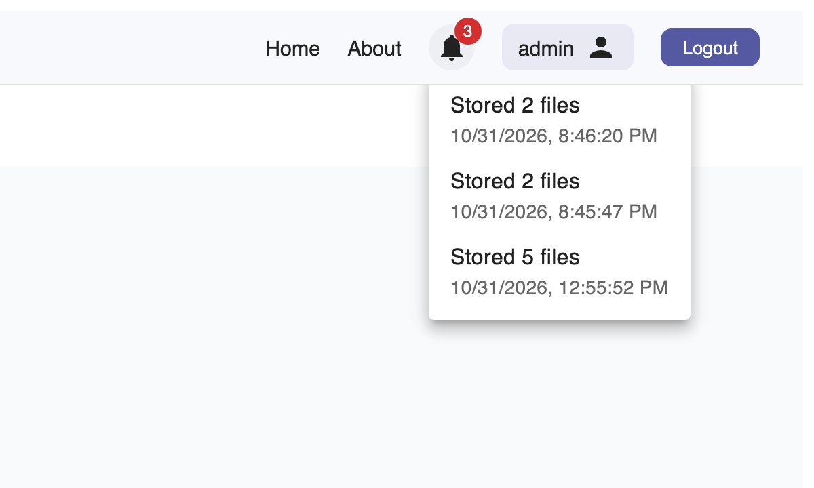

# Notifications

**Last updated:** 2026-10-31

How a researcher is told their upload is stored ([NT-1](../requirements/notifications.md#nt-1)): in the portal and by email. Completing an
upload records one notification per user in MongoDB; the navbar bell lists them. Each notification
is also passed to every delivery channel. Email is the only channel, and it's off until a mail relay
is set (`SMTP_HOST`). Emails name no files, since file names can identify participants.

Policies with an end date also raise notifications: administrators and the managers of the
instance's projects are reminded before a policy ends and on the day. The email says only the date.

Completing the same upload twice notifies once. A channel that fails is logged and never fails the
upload. What's been seen is kept in the browser.

| Setting | Meaning |
|---|---|
| `MONGO_NOTIFICATION_COLLECTION` | Collection for notifications (default `notifications`) |
| `SMTP_HOST`, `SMTP_PORT` (587), `SMTP_STARTTLS` (true), `SMTP_USER`, `SMTP_PASSWORD`, `SMTP_FROM` | Mail relay; email is off while `SMTP_HOST` is unset |
| `PORTAL_URL` | The link to the portal in each email |
| `POLICY_END_REMINDER_DAYS` (14), `POLICY_END_REMINDERS` (true) | Reminders before a policy ends ([AC-8](../requirements/access-control.md#ac-8)): how many days ahead, and whether the backend sends them at all |
