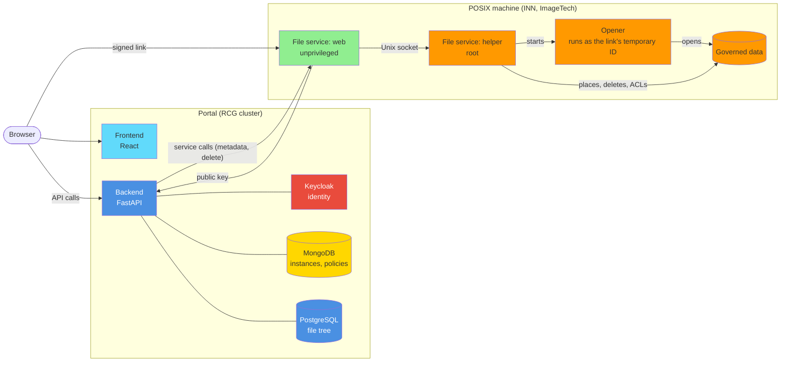
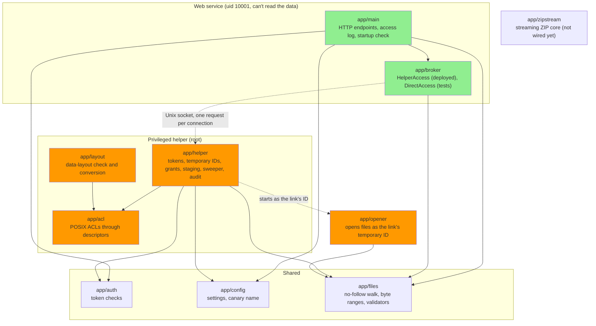
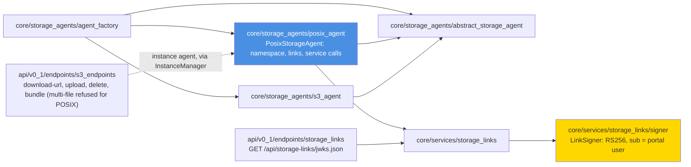

# POSIX Storage: Component Architecture

How the portal reaches data held on POSIX machines (INN and ImageTech). The narrative, decisions and
limits are in [docs/posix/README.md](../posix/README.md). Diagrams marked **checked** are compared with
the code by tests; see [How the diagrams are checked](../posix/README.md#how-the-diagrams-are-checked).

---

## System Overview

Where each piece runs. The portal never holds the data; it decides access and signs links. The file
service runs on the POSIX machine itself.

---

## File Service Modules (checked)

`storage-gateway/app`. Each solid arrow is a Python import, and every import between these modules
is drawn: a test fails if an arrow is missing or extra. The web side (`main`, `broker`) never imports
the privileged side (`helper`, `acl`, `opener`, `layout`); import-linter enforces that separately.
Dotted arrows are runtime relationships, not imports.

---

## Backend POSIX Modules (checked)

The parts of the portal backend that issue POSIX links. Solid arrows are imports among these modules,
all of them; the dotted arrow is a runtime call.

---

**Last Updated:** 2026-10-23
**Branch:** feature/posix-port
