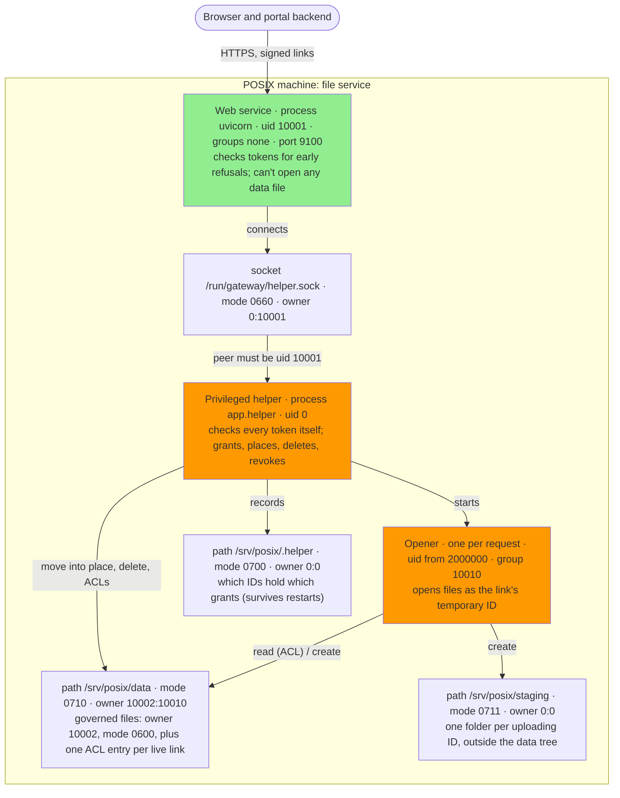

# POSIX Storage: Deployment

What runs on the POSIX machine, as which account, and the permissions that make the operating system
enforce each link's grant. Locally this is the `posix-gateway` container
(`local/docker-compose.posix.yaml`); on a real machine the same layout applies.

The **checked** diagram is compared with the running container by a test: each process's user and
groups, each path's mode and owner, and the socket's mode and owner must match the labels.

## Accounts

| Account | ID | Role |
|---|---|---|
| `gateway` | 10001 (group 10001) | The web service. No supplementary groups, so it can't pass through data folders. |
| `inndata` | 10002 (group 10002) | Owns the governed files. Nothing runs as it. |
| `posix-traverse` (group) | 10010 | Pass-through permission on data folders. Only openers get it. |
| temporary IDs | 2000000 + | One per approved link; no account entry. Read access through one ACL entry per granted file. |
| root | 0 | The helper. |

## Startup and failure

- The helper starts first, writes a canary file only `inndata` can read, revokes anything already
  expired, and opens its socket.
- The web service starts as `gateway` with `--no-new-privs`. It tries to read the canary: if it can,
  it refuses to start.
- If either process stops, the container stops. If the helper is unreachable, requests get 503;
  nothing falls back to direct access.

---

**Last Updated:** 2026-10-23
**Branch:** posix/stack
