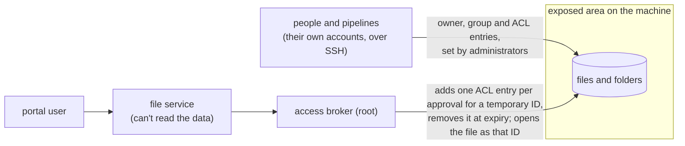

# POSIX Storage: Direct Access Alongside the Portal

People and their pipelines work on the machine with their own accounts; administrators and project
managers manage that access by hand over SSH (A1, 2026-10-31). The portal reaches files only through
the access broker, as one temporary ID per approval. The rules for who sets what are in the
[decision log](../design/decision-log.md#ds-data-owner);
each is tested in `tests_os/test_direct_access.py` and `tests_os/test_layout.py`.

