# POSIX Storage: Temporary ID Lifecycle

Each approved request (its links share an approval ID, `grant`; a link without one is its own request)
gets its own temporary user ID from a reserved range, the first time one of its links is used to read
or upload. This diagram is **checked**: a test drives the helper through every situation
and records the states each ID actually passes through. The transitions it observes must be exactly
these, no more and no fewer.

```mermaid
%% check: link-lifecycle
stateDiagram-v2
    [*] --> Free
    Free --> Active: an approval's first link is used (read or write)
    Active --> Quarantined: approval expired, every grant revoked on the same file
    Active --> Retired: approval expired, a granted file was moved or replaced on the machine
    Quarantined --> Free: quarantine period over
    Retired --> [*]
```

| State | Meaning | Where it's recorded |
|---|---|---|
| Free | Not held by any approval | absent from the helper's state |
| Active | Held by one live approval; may have ACL entries and a staging folder | `links` (keyed by approval ID, or link ID without one) |
| Quarantined | Approval expired and fully revoked; not reused yet, so audit records never mix two approvals | `quarantine` (until a time) |
| Retired | An ACL entry may survive on a moved file, so the ID is never reused; logged for an administrator | `retired` |

---

**Last Updated:** 2026-10-27
**Branch:** posix/stack
