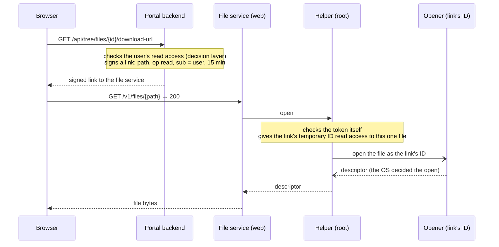
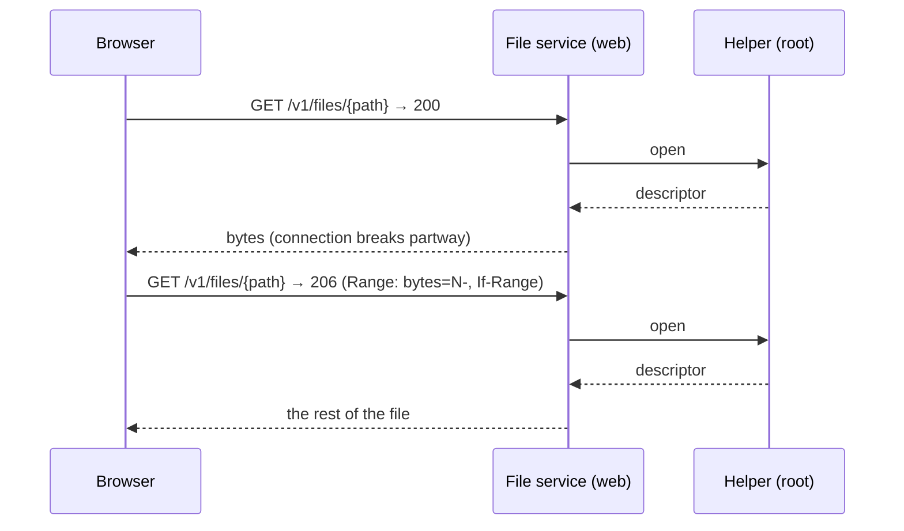
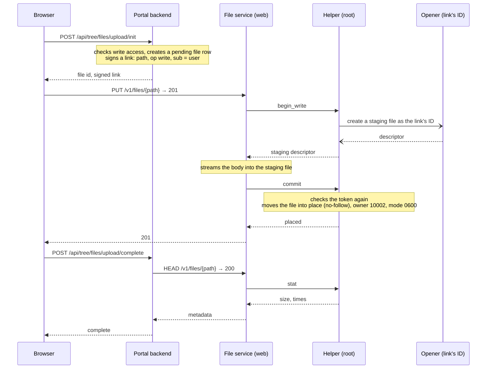
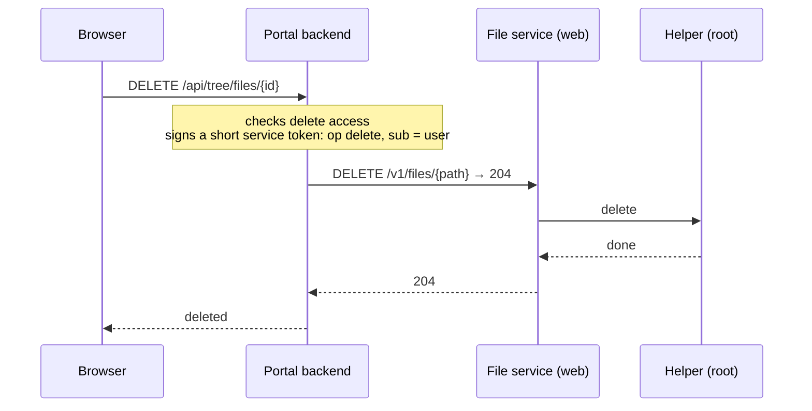
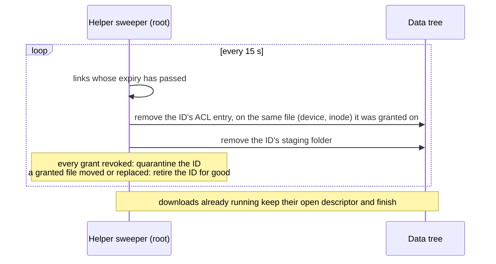

# POSIX Storage: Sequences

What happens, in order, for each operation on a POSIX instance. Each **checked** diagram is replayed
by an end-to-end test against the local stack: the test performs the operation through the portal,
collects what the backend, the file service and the helper logged, and compares it with the solid
arrows below, in order. Dashed replies, async arrows (to the opener) and notes are explanation only.
See [How the diagrams are checked](../posix/README.md#how-the-diagrams-are-checked).

Participants: **Backend** is the portal backend; **FileService** is the file service's web process
(uid 10001, can't read data); **Helper** is its privileged helper (root); **Opener** is a short-lived
process running as the link's temporary user ID.

---

## Download a File (checked)

## Resume a Broken Download (checked)

Links can be reused until they expire, so the browser asks for the rest of the file with the same
link. `If-Range` makes the file service send the whole file instead if it changed in between.

## Upload a File (checked)

The link's temporary ID writes only into a staging folder outside the data tree. The helper moves the
finished file into place and gives it to the data-owner account; temporary IDs never get write access
to data folders.

## Delete a File (checked)

POSIX can't grant "delete only this one file", so the helper carries out deletes itself after checking
the backend's delete token.

## Link Expiry

Every few seconds the helper's sweeper looks for expired links. The states an ID moves through are
in [the link lifecycle](./posix-link-lifecycle.md).

---

**Last Updated:** 2026-10-23
**Branch:** posix/stack
