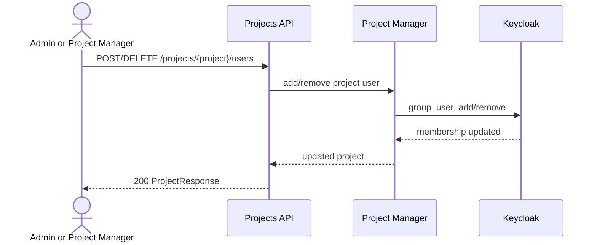
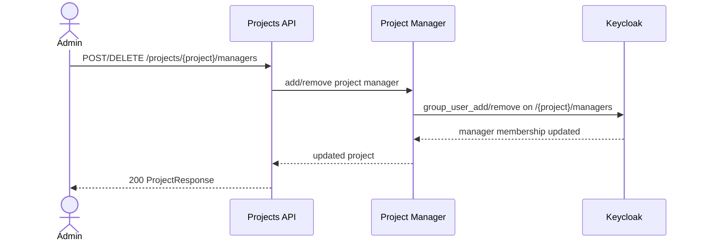
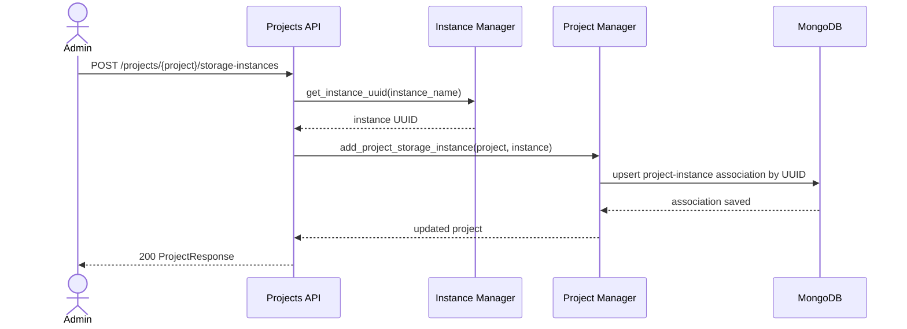
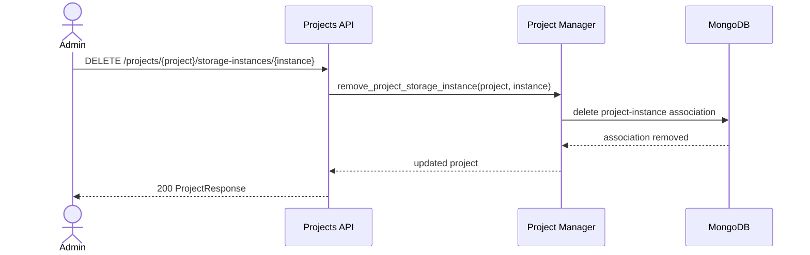

**Last Updated:** 2026-06-29

# Project Membership Management Sequence Diagrams

## Add or Remove Project User

## Add or Remove Project Manager

## Add Storage Instance

## Remove Storage Instance

