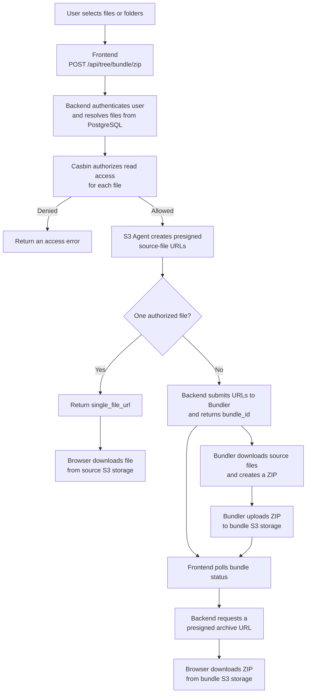
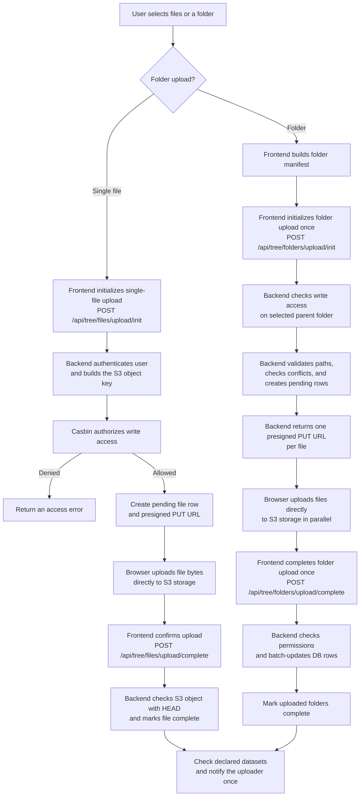
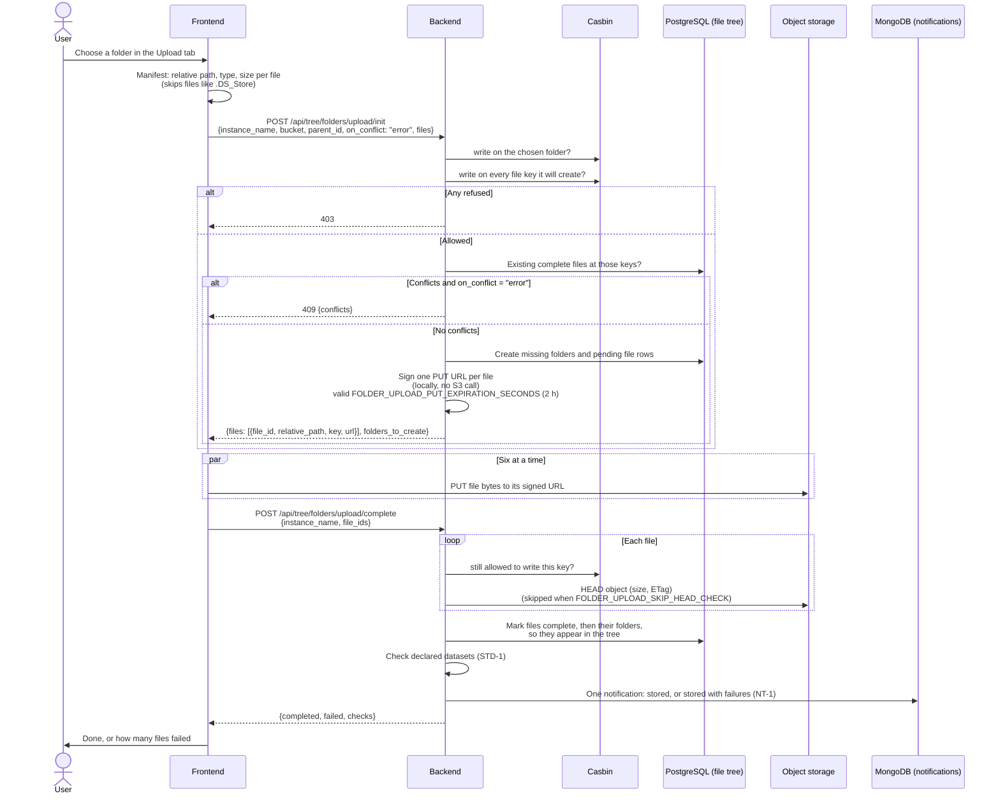
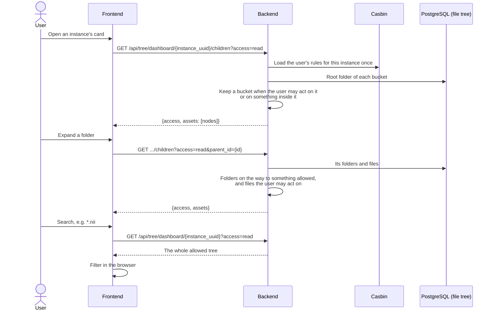
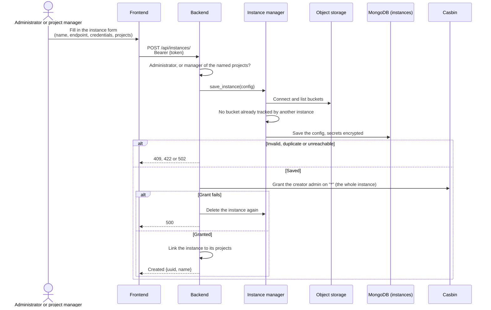
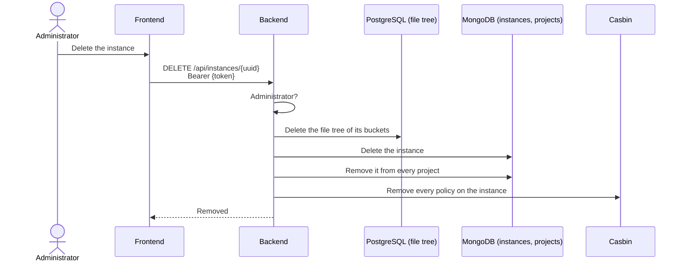

# Storage Access Diagrams

## File Download Flow (S3)

The asset UI uses the bundle endpoint for every selection. A single resolved file
is downloaded directly; multiple files are assembled asynchronously into a ZIP.

## File/Folder Upload Flow (S3)

Files are uploaded directly from the browser to S3 using a short-lived
presigned PUT URL. The backend manages authorization and file metadata.

## Folder Upload

One request prepares the whole folder, the browser sends the bytes straight to object storage,
and one request completes it. Write access is checked on the chosen folder and on every file it
will create, before anything is created ([AC-3](../requirements/access-control.md#ac-3)).

Completing the same upload again changes nothing and doesn't notify twice. See also
[Notifications](notifications.md) and [Data standards](data-standards.md).

## File Tree Loading

The tree comes from the file tree in PostgreSQL, not from listing object storage. Each tab
(Download, Upload, Delete) asks for the tree for its own action, so it shows what the user may do
that to ([AC-1](../requirements/access-control.md#ac-1), [AC-2](../requirements/access-control.md#ac-2)).
Browsing loads one folder at a time; searching loads the whole tree once and filters it in the browser.

## Storage Instance Creation

An administrator or project manager adds an instance. Its creator is granted the whole instance.

## Storage Instance Deletion

Only an administrator can delete an instance. The files in object storage are left alone.

---

## Storage Agent Operations

### Supported Operations

Every storage agent (`backend/core/storage_agents/`) provides these; the S3 agent is the one in use.

| Operation | Does |
|-----------|------|
| `generate_access_link(resource, method, ttl)` | A short-lived signed URL to read (`read`) or upload (`write`) one object |
| `get_object_metadata(resource)` | Size, ETag, type and date of an object (HEAD), to confirm an upload |
| `delete_object(resource)`, `delete_objects(resources)` | Delete one object, or many |
| `fetch_all_buckets()` | The instance's buckets, for the tree and for bucket uniqueness |
| `connect()`, `close()` | Open and close the connection; connecting checks the credentials |

### Presigned URL Security

**S3 Presigned URLs include:**
- AWS Access Key ID (in query params)
- Signature (HMAC-SHA256 of request)
- Expiration timestamp
- Specific operation (GET/PUT/POST)
- Resource path (locked to specific object)

**Validation by S3:**
1. Check signature matches request
2. Verify not expired
3. Confirm operation matches
4. Validate resource path

---

## Access Control Patterns

Policy paths are literal: a file, a folder and everything in it (`folder/*`), or `*` for the whole
instance. The full guide, with what each policy allows: [Policies](../user-guide/policies.md).

| Policy (path, action) | Allows |
|---|---|
| `*`, `read` | Reading every file in the instance |
| `study/project1/*`, `read` | Reading everything in `study/project1/`, including files added later |
| `study/shared/*`, `read` and `study/uploads/*`, `write` | Reading from `shared`, uploading to `uploads` |
| `*`, `admin` | Everything, on the whole instance (what an instance's creator gets) |

---

**Last Updated:** 2026-10-31
