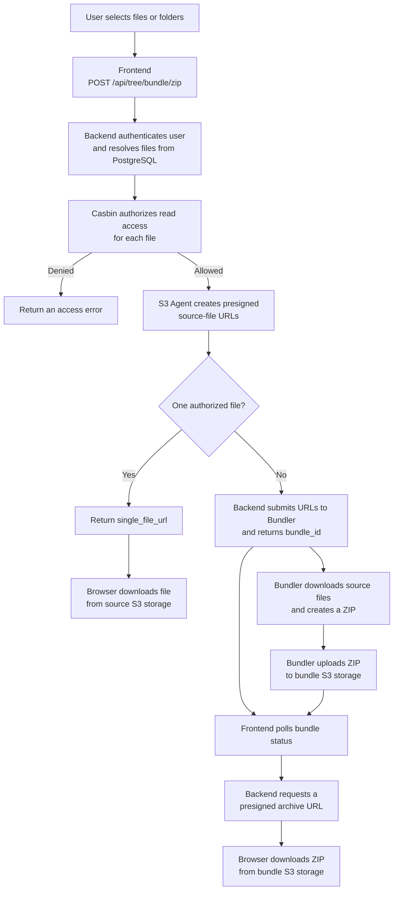
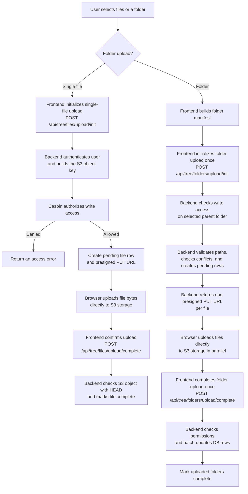
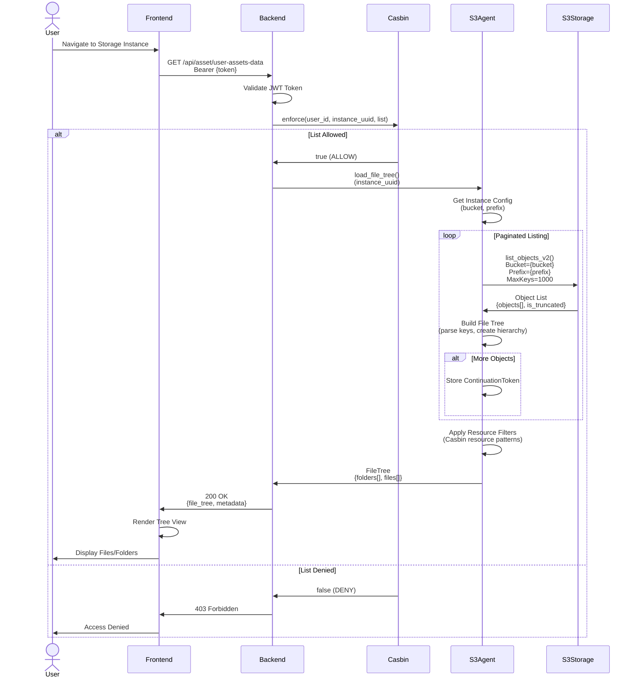
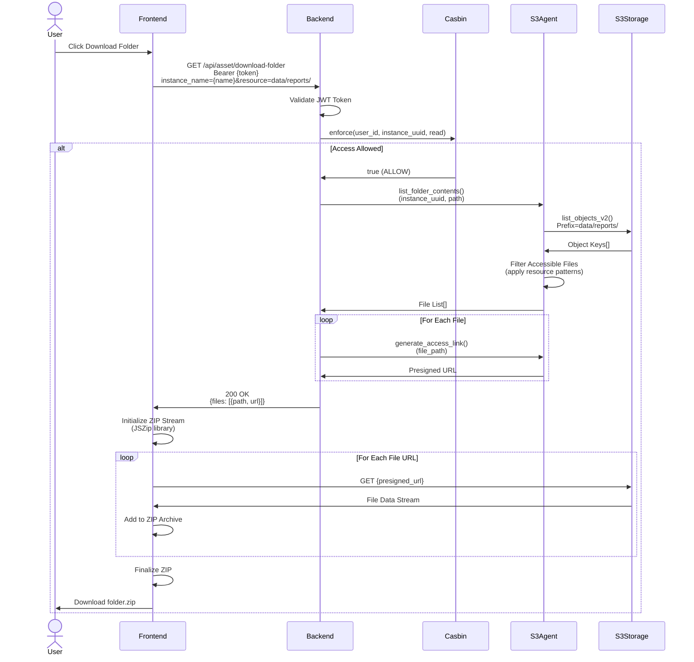
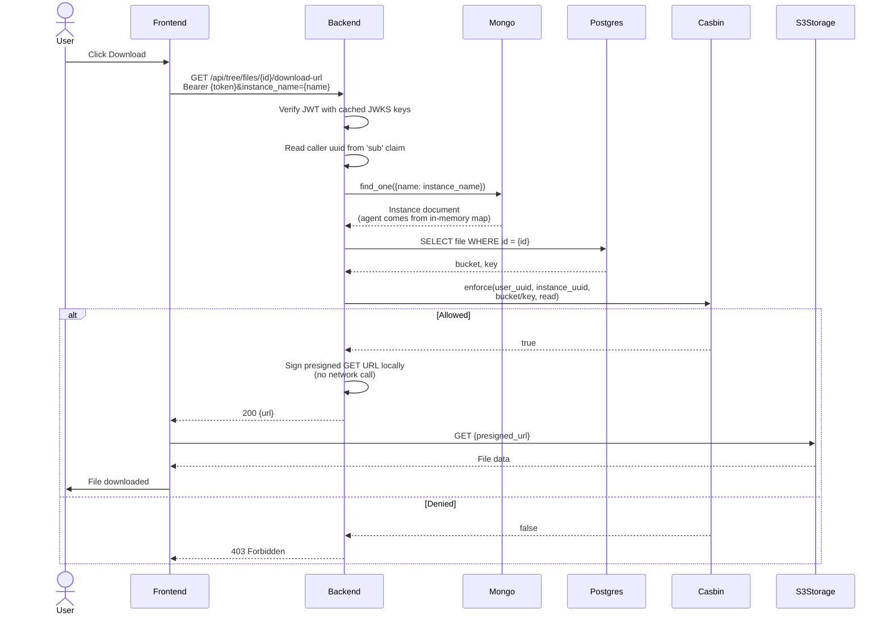
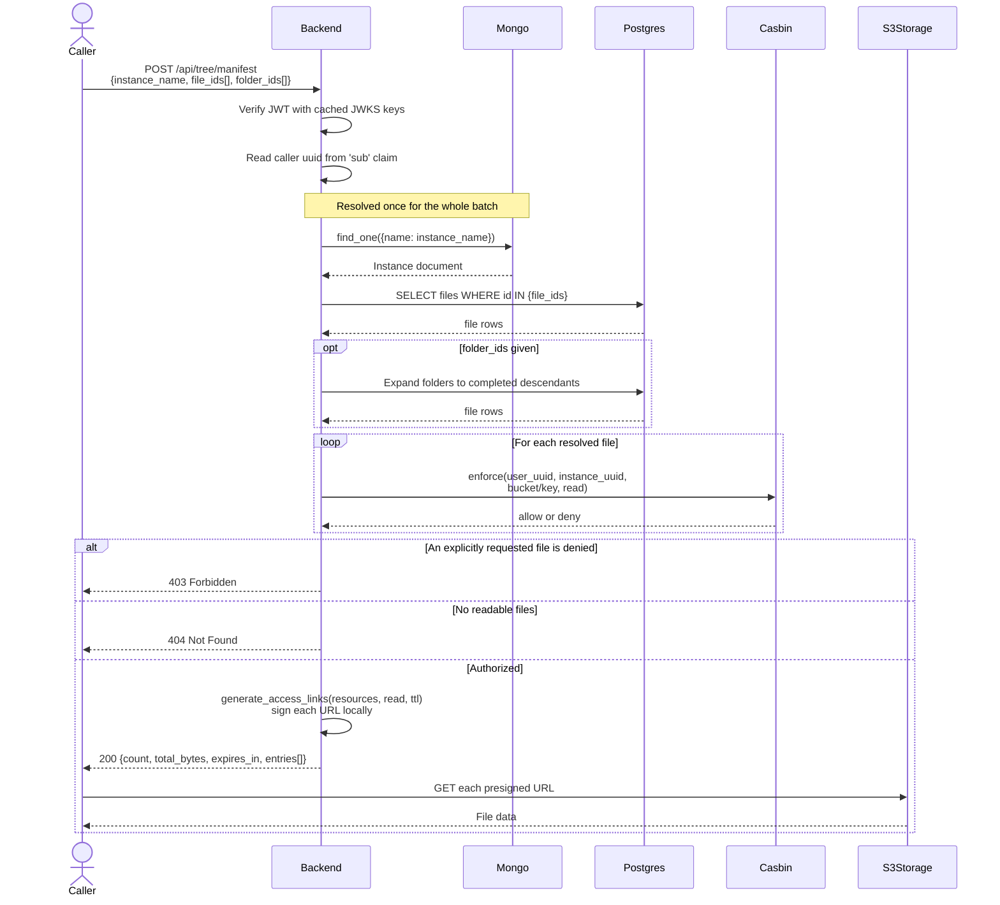
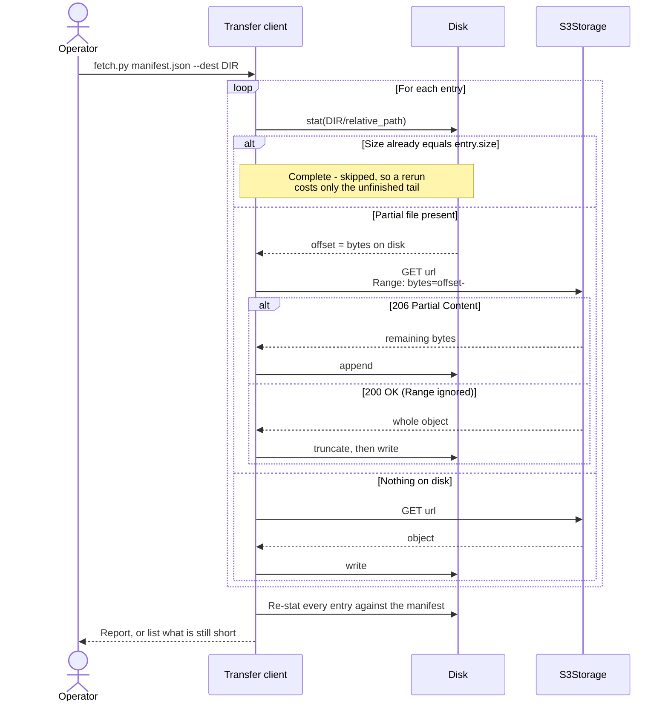
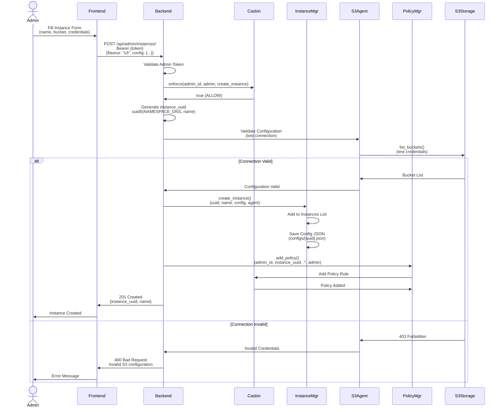
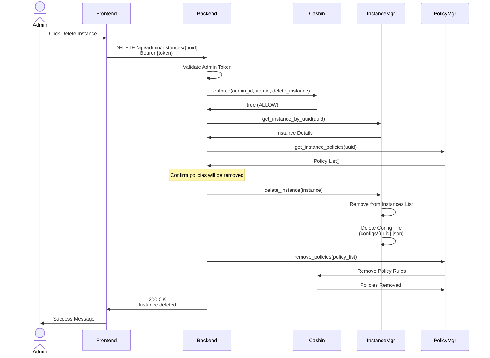

# Storage Access Diagrams

## File Download Flow (S3)

The asset UI uses the bundle endpoint for every selection. A single resolved file
is downloaded directly; multiple files are assembled asynchronously into a ZIP.



## File/Folder Upload Flow (S3)

Files are uploaded directly from the browser to S3 using a short-lived
presigned PUT URL. The backend manages authorization and file metadata.



## File Tree Loading

Loading directory structure from storage backend.



## Folder Download (ZIP)

> **Outdated.** This describes `GET /api/asset/download-folder` returning a list of
> presigned URLs for the browser to assemble with JSZip. That endpoint no longer
> exists: multi-file downloads now go through `POST /api/tree/bundle/zip`, which
> hands the work to the bundler service. See "File Download Flow (S3)" above for the
> current shape. Kept for historical reference until it is rewritten.

Downloading an entire folder as a ZIP archive.



## Single File Download URL

`GET /api/tree/files/{file_id}/download-url` — the request the browser makes for each
file it wants. No call reaches Keycloak or the object store: identity comes from the
verified token, the policy check is in memory, and presigning is local crypto.



Per request this is one Mongo read, one Postgres read, one in-memory policy evaluation
and one local signing operation. Earlier revisions also made two Keycloak round trips
(OIDC discovery plus a JWKS fetch) and a third to resolve the caller's username into a
uuid, and read the instance document twice; those were removed in 2026-09.

## Bulk Manifest

`POST /api/tree/manifest` - one presigned URL per authorized file, in a single request.
Accepts file ids, folder ids, or both; folders expand to their completed descendants.

The cost that matters is the round trip. Asking for N files here is one request rather
than N: the caller's identity and the storage instance are resolved once for the whole
batch, and presigning is local crypto with no network call, so the marginal cost per
file is small. Over a link with real latency this is the difference between paying the
round trip once and paying it N times.



Each entry carries `file_id`, `bucket`, `key`, `relative_path`, `size`, `etag` and
`url`, so a client can reconstruct the tree it asked for without a second call.

`relative_path` is the full `bucket/key`, so a manifest spanning buckets cannot collide
on disk. `etag` is a change detector rather than a checksum - a multipart upload yields
`<hash>-<partcount>`, which depends on part size rather than content alone - so a client
verifies by byte count and uses the etag only to notice that an object changed.

Only `url` and `relative_path` are needed to perform the transfer; the rest is
information the caller may or may not use.

### Denied files: 403 or skipped

The two cases differ deliberately. A file named **explicitly** in `file_ids` that the
caller cannot read raises 403 - asking for something specific and silently not getting
it is worse than an error. A file reached by **expanding a folder** is skipped instead,
because a folder the caller can partly read should return the readable part.

Both paths go through `resolve_authorized_files`, which the bundle endpoint also uses,
so a manifest and a bundle of the same selection make the same authorization decision.

### Redeeming a manifest: resumable transfer

A manifest is data, not a transfer. Something else redeems it - `protocol/client/fetch.py`
is the reference implementation, but the format is deliberately plain enough that a job
on the destination cluster or a container the receiving institution runs could do the
same.

What makes an unattended move of a large dataset possible is that **the partial files on
disk are the entire state**. The resume offset is the size of the file already there, so
there is no journal to corrupt and no sidecar to fall out of sync; an interrupt at any
moment leaves something valid to continue from.



The backend is absent from this diagram, which is the point: it issued the references
and is out of the data path. Bytes move between storage and the destination over 443,
so no component has to be installed inside the network holding the data.

Two consequences worth stating, because they bound what this design gives you:

- **A presigned URL expires.** The TTL is fixed when the manifest is minted, so a
  transfer longer than that window needs a fresh manifest rather than a longer wait.
  Re-minting mid-transfer, against current policy, is the recorded direction in
  `workstreams/data-transfer/STATUS.md`; it is not implemented here.
- **Integrity is byte count, not content.** See the etag note above.

## Storage Instance Creation

Admin creating a new storage instance.



## Storage Instance Deletion

Admin deleting a storage instance and associated policies.



---

## Storage Agent Operations

### Supported Operations

| Operation | S3 Agent | Dummy Agent | Description |
|-----------|----------|-------------|-------------|
| `generate_access_link()` | ✅ Presigned GET URL | ✅ Mock URL | Get download URL |
| `generate_upload_link()` | ✅ Presigned PUT URL | ✅ Mock URL | Get upload URL |
| `load_file_tree()` | ✅ S3 list_objects | ✅ Mock tree | List files/folders |
| `validate_config()` | ✅ Test credentials | ✅ Always valid | Check connection |

### Presigned URL Security

**S3 Presigned URLs include:**
- AWS Access Key ID (in query params)
- Signature (HMAC-SHA256 of request)
- Expiration timestamp
- Specific operation (GET/PUT/POST)
- Resource path (locked to specific object)

**Validation by S3:**
1. Check signature matches request
2. Verify not expired
3. Confirm operation matches
4. Validate resource path

---

## Access Control Patterns

### Pattern 1: User-Level Access
```
p, user_uuid, instance_uuid, .*, read
```
User can read all files in the instance.

### Pattern 2: Resource-Level Access
```
p, user_uuid, instance_uuid, data/project1/.*, read
```
User can only read files in `data/project1/` folder.

### Pattern 3: Operation-Level Access
```
p, user_uuid, instance_uuid, data/shared/.*, read
p, user_uuid, instance_uuid, data/uploads/.*, write
```
User can read from `shared` but only write to `uploads`.

### Pattern 4: Admin Access
```
p, admin_uuid, instance_uuid, .*, admin
```
Admin has full control (read, write, delete, manage).

---

**Last Updated:** 2025-10-23
