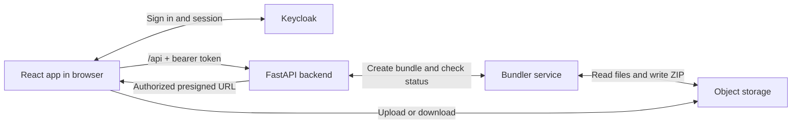

# Frontend Architecture

## At a glance

The frontend is a Create React App single-page application.



The main pieces are:

| Concern | Implementation |
| --- | --- |
| UI | React 19 and Material UI |
| Routing | React Router |
| Authentication | Keycloak through `@react-keycloak/web` |
| API calls | Axios and `fetch` |
| State | Local component state and custom hooks |
| Styling | Material UI plus feature-specific CSS |

There is no application-wide state store.

## Startup flow

1. `frontend/src/index.js` renders `App`.
2. `App` initializes Keycloak with `ReactKeycloakProvider`.
3. `App` initializes client-side routing with `BrowserRouter`.
4. `AppRouter` chooses a public or authenticated page.

Keycloak uses `check-sso` to detect an existing session without forcing a login.
The silent check returns through `frontend/public/silent-check-sso.html`.

## Routes

`frontend/src/router/AppRouter.js` defines the top-level routes:

| Route | Behavior |
| --- | --- |
| `/` | Shows the landing page, or redirects an authenticated user to `/app`. |
| `/app/*` | Requires authentication and selects an interface from token claims. |
| `/about` | Shows public information about the portal. |

Authenticated users see:

| Claim | Interface |
| --- | --- |
| `admin` realm role | Administration interface |
| Project path ending in `/managers` | Administration interface |
| Neither | Normal-user interface |

The administration interface contains user, project, policy, asset, and storage
connection pages. The normal-user interface contains asset and policy tabs.

Feature guides:

- [Asset management](./features/admin/asset-management/README.md)
- [Project management](./features/admin/project-management.md)
- [Policy management](./features/admin/policy-management.md)
- [Storage management](./features/admin/storage-management.md)
- [User management](./features/admin/user-management.md)
- [Normal-user interface](./features/normal-user/README.md)

## Authentication

`frontend/src/setting/Keycloak.js` creates the Keycloak client from these build-
time environment variables:

- `REACT_APP_KeycloakServerUrl`
- `REACT_APP_KeycloakRealm`
- `REACT_APP_KeycloakClientId`

Before an authenticated request, `getAuthHeaders`:

1. asks Keycloak to refresh a token that expires within 30 seconds;
2. returns the current token as an `Authorization: Bearer <token>` header.

### Authentication is not authorization

| Layer | What it decides |
| --- | --- |
| Keycloak claims | Who the user is and which interface is displayed |
| FastAPI and Casbin | Which resources the user may read, write, delete, or administer |

A visible route or button does not prove that an operation is allowed. The
backend is always the source of truth.

## Folder Structure

```text
frontend/src/
|-- index.js                         Application entry point
|-- App.js                           Keycloak and router providers
|-- router/AppRouter.js              Top-level routes and interface selection
|-- setting/Keycloak.js              Keycloak client configuration
|-- utils/                           Shared authentication and error helpers
`-- components/
    |-- navbar/                      Global navigation and login/logout
    |-- landing_page/                Public landing page
    |-- about/                       Public about page
    |-- normal_user_page/            Assets and policies for regular users
    `-- admin_page/
        |-- user_management/         Keycloak user administration
        |-- project_management/      Project membership and storage assignment
        |-- policy_management/       Casbin policy administration
        |-- asset_management/        Authorized tree browsing and file actions
        `-- storage_management/      Storage-instance configuration
```

Features keep their request, loading, and error state close to the component that
uses it. Shared or complex behavior may move into a custom hook, such as
`useStorageInstances` or `useEndpointAssetTree`.

## Asset flow

1. Load the storage instances visible to the user.
2. Load the authorized tree for the selected instance and access type.
3. Ask the backend to authorize an upload, download, bundle, or delete.
4. Transfer file data using the method returned by the backend.

The tree has separate read, write, and delete views:

- **Browse mode** loads roots first, then loads folders when they are opened.
- **Search mode** loads the full authorized tree, then filters it in the browser.

See [Asset loading](./features/admin/asset-management/loading.md) and
[asset searching](./features/admin/asset-management/searching.md) for details.

File actions follow these paths:

| Action | Flow |
| --- | --- |
| Upload | Backend authorizes and returns a presigned request; the browser uploads to object storage. |
| Single-file download | Backend authorizes and returns a storage URL. |
| Multi-file download | Backend starts a bundle; the browser polls and then opens the archive URL. |
| Delete | Backend authorizes the request and updates storage and tree metadata. |

The portal makes access decisions. Object storage handles most file bytes.
