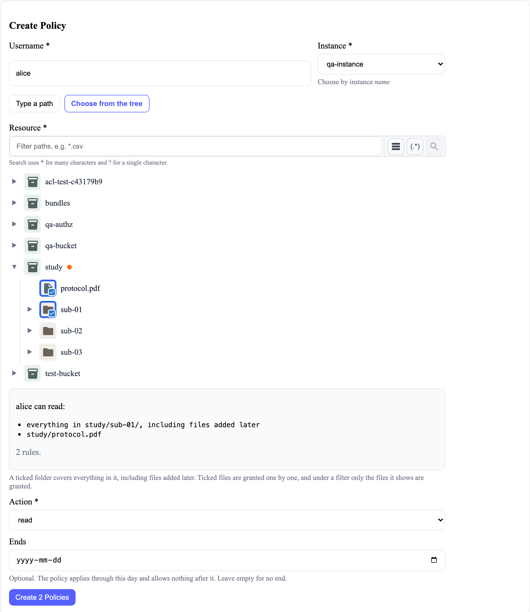

# Policy Management

Policy management controls which user can perform an action on a storage
resource. What a policy does, and how to write one, for the people who use this page:
[Giving people access](../../../user-guide/policies.md) and [How access works](../../../user-guide/how-access-works.md).

## Policy fields

| Field | Meaning |
| --- | --- |
| Username | User receiving the permission. |
| Instance | Storage instance containing the resource. |
| Resource | One file (`bucket/path/file.ext`), a folder and everything in it (`bucket/folder/*`), or everything on the instance (`*`). Typed, or chosen from the instance's file tree. |
| Action | `read`, `write`, `delete`, or `admin`. |
| Leave out | Optional, for a folder policy: paths inside it that it leaves out, one per line. The tree picker fills this when a ticked folder has things unticked inside it. |
| Ends | Optional: the last day the policy applies. The **Policies** table shows it, or **Never**, or **Ended** and the date once it's past. |

Resource paths are literal, not patterns: `bucket/folder/*` covers that folder and
everything in it, any other path names exactly one file, and `*` covers everything.
The backend saves paths without a leading `/` and refuses a `*` anywhere except on its
own or at the end of a folder path. Decisions are made in
`backend/core/services/policies/rules.py`; requirements are in
`docs/requirements/access-control.md`.

## Page flow

1. Load the storage instances available to the current user.
2. Load the policies the current user is allowed to manage.
3. Create a policy from a username, instance, resource, and action. The resource is typed, or
   chosen from the file tree (below).
4. Refresh the policy table after a successful change.

## Choosing from the file tree

**Choose from the tree** loads the chosen instance's tree for the signed-in user (the same
`/api/tree/dashboard/{instance_uuid}` requests as asset management, `access=read`) and turns the
ticks into rules: a folder ticked with no filter active is `folder/*`; ticked files are one rule
each, never collapsed into their folder; under a filter, one rule per file the filter shows. The
tree doesn't select a folder because all its files are ticked here (`promoteSelection={false}`),
so the two can be told apart. The rules are listed in plain words before saving, and each is sent
as its own `POST /api/policies/`; any refused are named. Behaviour is specified in
`policy_management/features/policy-from-selection.feature`.

Deleting a policy requires confirmation.

## API calls

| Method | Endpoint | Purpose |
| --- | --- | --- |
| `GET` | `/api/instances/` | Populate the storage-instance list. |
| `GET` | `/api/policies/` | List manageable policies. |
| `POST` | `/api/policies/` | Create a policy. |
| `DELETE` | `/api/policies/` | Delete a policy. |

The frontend displays friendly usernames and instance names. Policy deletion
currently sends the policy's user UUID, instance UUID, resource, and action back
to the API.

## Authorization

Administrators and project managers can reach the management interface. The
backend determines which instances and policies they may view or change. A
visible form is not proof that a submitted policy is allowed.

Keycloak roles and Casbin policies have different purposes:

- Keycloak controls identity and coarse interface access.
- Casbin controls resource-level permissions.

## Main source files

| Purpose | File |
| --- | --- |
| Page, form, table, and API calls | `frontend/src/components/admin_page/policy_management/index.js` |
| Choosing from the tree, and the preview | `frontend/src/components/admin_page/policy_management/TreePicker.js` |
| Turning ticks into rules | `frontend/src/components/admin_page/policy_management/treeRules.js` |
