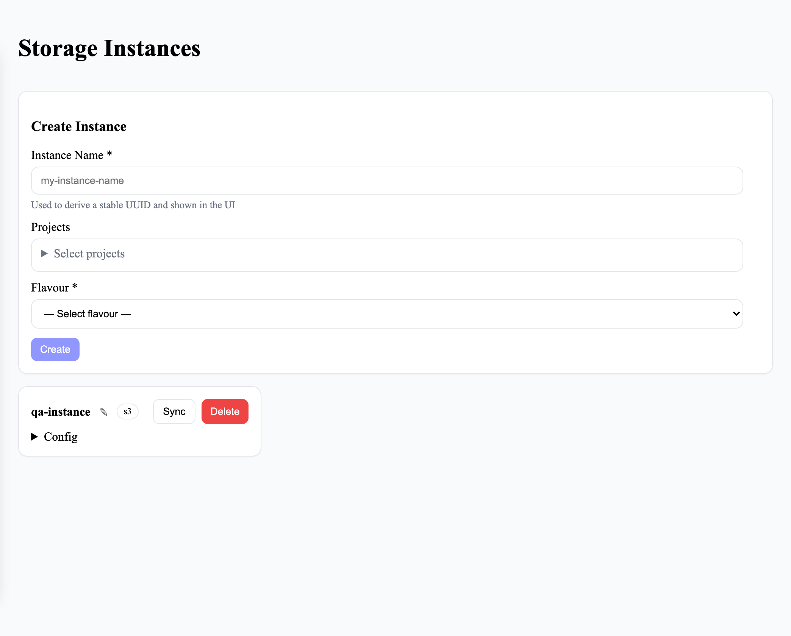

# Storage, projects and users

Connect storage, set up projects and create accounts. For administrators and project managers;
giving people access to data is on its own page, [Giving people access](policies.md).

## Before you start

You need to be an administrator or a project manager. Project managers see the same admin panel, but
can act only on the projects they manage, and some actions are for administrators only (see the
tables below).

## Connect storage
<!-- claim: AC-5; tests: test_a_new_instance_grants_its_creator_a_rule_the_portal_accepts -->

1. In the admin panel, open **Connection Management**.
2. Under **Create Instance**, enter an **Instance Name** and, optionally, the **Projects** it belongs
   to.
3. Choose the **Flavour**: `s3` for S3-compatible object storage.
4. Enter the **S3 Endpoint URL**, **Access Key** and **Secret Key** (and **Region Name** if the
   storage needs one), then choose **Create**.

The portal checks it can connect before saving. The instance then appears as a card, and you are
given full access to it. Secret keys are masked whenever an instance's settings are shown.

On an instance's card:

- **Sync** reads what's in storage, so files added outside the portal appear in it. It can take a
  while on a large store.
- **Delete** removes the instance, its file list and every policy on it from the portal. The files
  in storage are left alone.

| Action | Administrator | Project manager |
|---|---|---|
| Add an instance | Yes | Yes, for projects you manage |
| Sync it | Yes | Yes, for projects you manage |
| Rename it | Yes | No |
| Delete it | Yes | No |

## Set up a project

1. Open **Project Management** and choose **Create Project**. Give it a name.
2. Open the project's card. In **Manage Project**, add people under **Users** and **Managers**, and
   storage under **Storage Instances**.

| Action | Administrator | Project manager |
|---|---|---|
| Add or remove a project's users | Yes | Yes |
| Create or delete a project | Yes | No |
| Add or remove managers | Yes | No |
| Assign storage to a project | Yes | No |

## Create an account

1. Open **User Management**.
2. Under **Create / Update User**, enter the username, password, full name, email and roles, then
   choose **Create User**.

Project managers can't create administrators; only administrators can delete accounts. A new
account can't see any data until it's given access: see [Giving people access](policies.md).

## Related

- [Giving people access](policies.md)
- [How access works](how-access-works.md)
