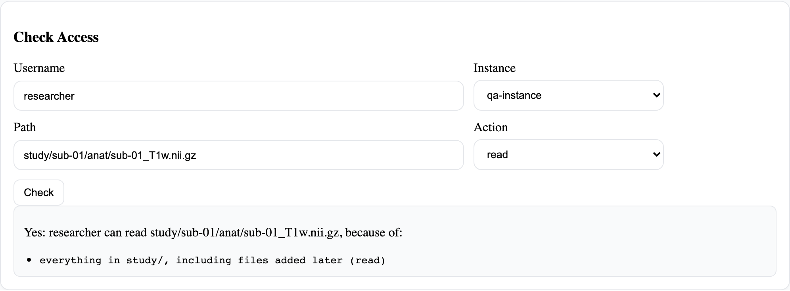

# Checking someone's access

Find out whether a person may read, write or delete a file or folder, and which of their policies
allows it. Use it when someone says they can't open something, or before you remove a policy.

## Before you start

You need to be an administrator, or the project manager of a project the person belongs to. A
project manager can check people in the projects they manage, on those projects' storage.

## Steps

1. Open **Policy Management**.
2. Under **Check Access**, choose **Check someone's access**.
3. Enter the person's username, choose the storage instance, and enter the path: a file
   (`study/sub-01/anat/t1.nii`) or a folder ending in `/` (`study/sub-01/`).
4. Choose the action, then **Check**.

## Result
<!-- claim: AC-1, AC-3; tests: test_check_access_names_the_policy_that_allows_it, test_check_access_refuses_with_no_reason, test_check_access_says_a_folder_is_shown_without_being_allowed -->

The portal answers as it would decide a real request today:

- **Yes**, with each of the person's policies that allows it. There can be more than one, because
  policies add up.
- **No**, when none of their policies allows it. Policies never take access away, so there's nothing
  else to look for: give a policy if they should have access.
- **For a folder**, also whether it appears in their tree. A folder appears when they hold something
  inside it, but that doesn't let them act on the folder itself.

## If something goes wrong
<!-- claim: AC-3; tests: test_check_access_is_refused_to_an_ordinary_user, test_a_manager_may_check_only_people_in_their_projects -->

- **"User or instance not found"**: check the spelling of the username, and choose the instance
  from the list.
- **"Access denied: user and instance must belong to a project you manage"**: you're a project
  manager, and the person or the storage isn't in one of your projects. Ask an administrator.

## Related

- [Giving people access](policies.md)
- [How access works](how-access-works.md)
