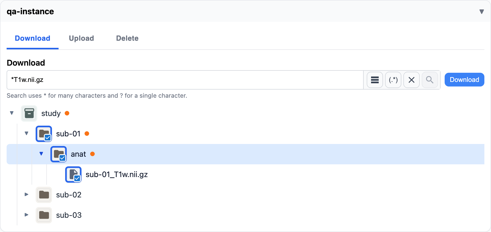

# Finding and downloading files

Open the storage instance's card and choose the **Download** tab.

## Finding files

- **Browse:** open folders with the arrow beside them. Their contents load as you go.
- **Search:** type a pattern in the filter box and press Enter: `*` matches any characters and `?`
  one, so `*.nii.gz` finds every compressed scan. The `(.*)` button switches to regular
  expressions. The list button shows only what you've already ticked.

Starting or clearing a search clears what you've ticked.

## Choosing what to download
<!-- claim: AC-4; tests: Selecting the only visible file in a folder doesn't select the folder, A folder whose own name matches the filter is selected whole, test_a_download_refuses_a_selected_file_the_user_may_not_read, test_a_folder_download_holds_only_files_the_user_may_read -->

Tick files or folders. Ticking a folder ticks everything in it.

While a search is on, ticking a folder ticks only the files the search shows, so you download
what you see. A folder whose own name matches the search shows, and ticks, everything in it.

A download holds only files you may read.

## Downloading
<!-- claim: AC-3; tests: test_the_user_who_asked_for_a_bundle_can_fetch_it, test_another_users_bundle_cant_be_checked_or_fetched, test_a_bundle_is_refused_once_access_to_a_file_in_it_is_revoked -->

Choose **Download**.

- **One file** downloads straight away.
- **Several files or a folder** become one ZIP file. The button shows "Preparing download…" with
  a timer while it's made, then your browser downloads it. Large selections take a while.

Only you can fetch a ZIP you asked for. If your access to a file in it is removed before you
fetch it, the download is refused.
