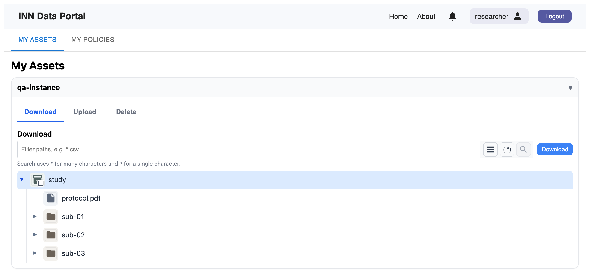
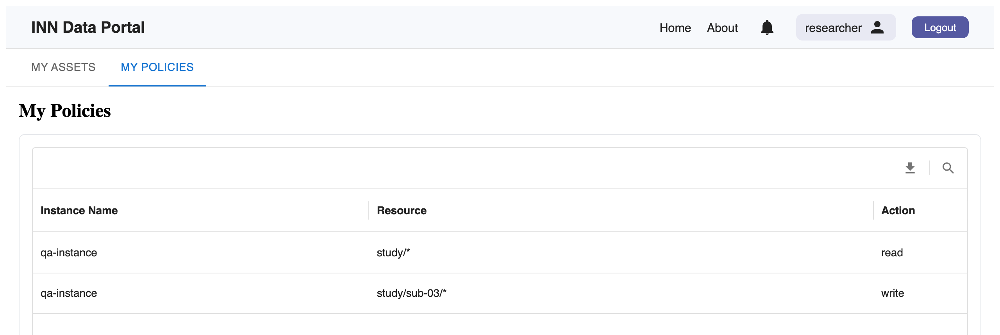
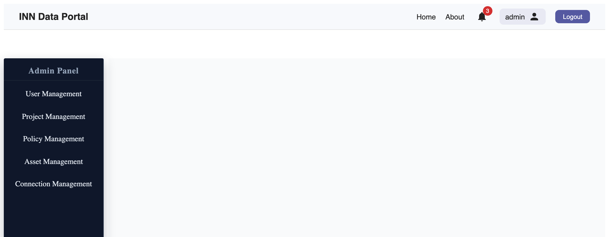

# Getting started

Open the portal and choose **Login**, then sign in with your portal account. Your administrator
or project manager gives you the account and the access that goes with it.

## What researchers see

Two tabs: **My Assets**, your data, and **My Policies**, a list of the access you've been given.

Each storage instance is a card. Open one to see three tabs, one per action: **Download**,
**Upload** and **Delete**.

## You see what you may use
<!-- claim: AC-1; tests: test_a_listing_for_an_action_shows_what_the_user_may_do_it_to, test_listings_above_a_file_show_only_the_path_to_it, test_a_folder_listing_shows_only_files_the_user_may_read -->

Each tab shows only what you may do that action to. You might see a whole study under
**Download** but only one folder of it under **Upload**. A folder is shown when it leads to
something you may use; other files in that folder stay hidden. If a tab is empty, you haven't
been given that kind of access there.

## Your access
<!-- claim: AC-5 -->

**My Policies** lists each permission you hold: the instance, the path, and the action. A path
ending in `/*` covers that folder and everything in it, including files added later; any other
path is one file. You can't change your own access here: ask your administrator or project
manager.

## What administrators and project managers see

An admin panel with a section for each kind of work. **Asset Management** is the same as a
researcher's **My Assets**.

The bell at the top shows [notifications](notifications.md).
