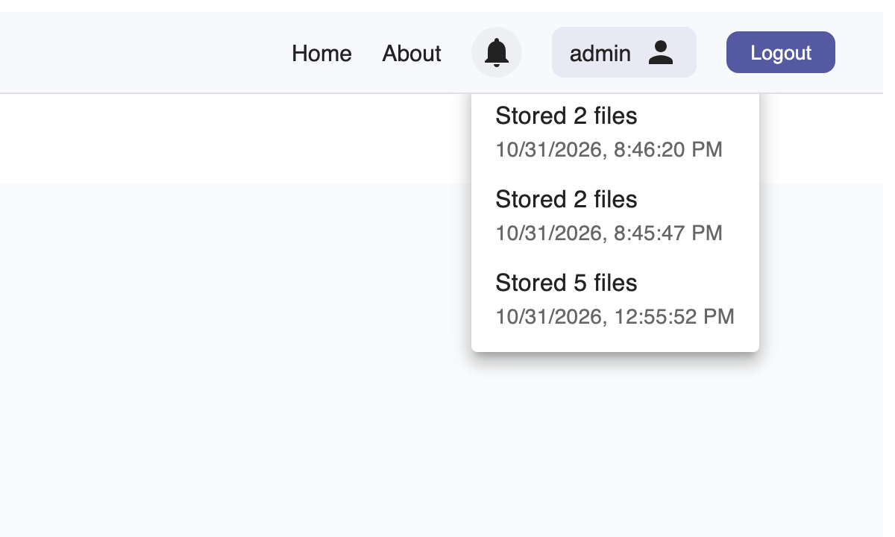

# Notifications
<!-- claim: NT-1; tests: test_a_stored_upload_is_recorded_for_its_researcher, test_a_folder_upload_is_one_notification_with_its_counts, test_the_endpoint_lists_only_the_callers_own, test_newest_first_and_capped, test_an_email_tells_the_researcher_without_naming_files, test_an_email_says_when_files_failed, test_email_is_off_until_a_relay_is_set -->

When your upload is stored, the portal tells you. The bell at the top shows how many
notifications are new; open it to see them, newest first.

- A file upload says "Stored" and the file's name.
- A folder upload is one notification with how many files were stored, and how many failed, if
  any did.
- You see only your own notifications, up to the newest 50. The bell checks for new ones every 30
  seconds.

If the portal has email set up, you're also sent an email. It never names your files, since file
names can identify participants; it says how many were stored and links to the portal.
