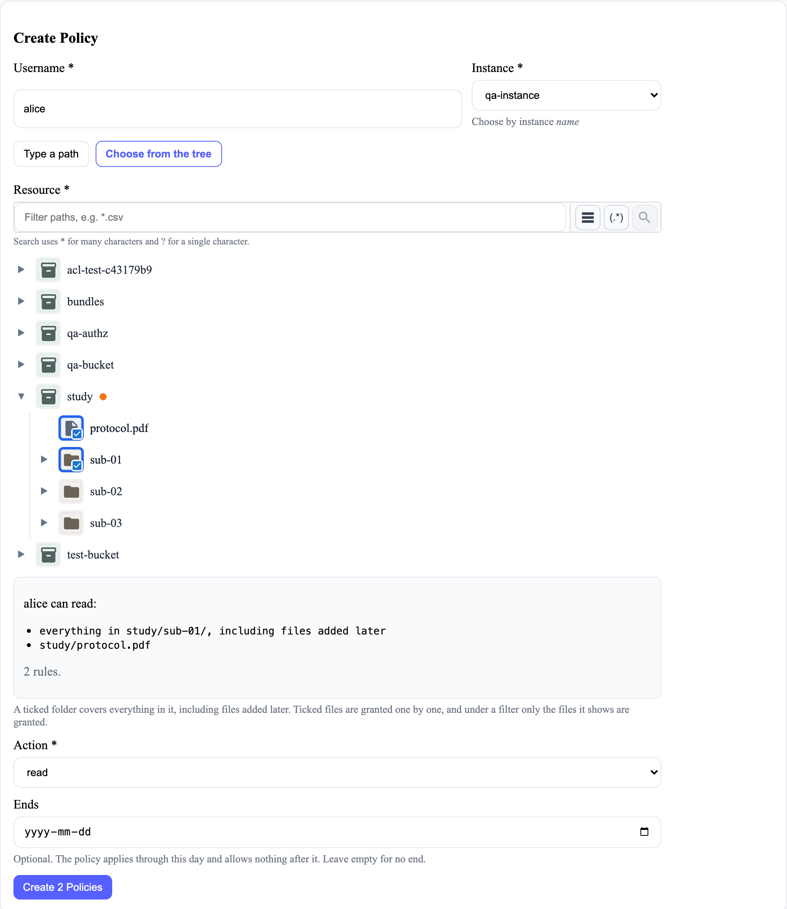

# Giving people access

Give someone access to data on a storage instance by adding a policy: one person, one instance,
one path and one action. A person's access is everything their policies give, added together.

## Before you start

- You need to be an administrator, or the manager of a project that includes the person and the
  instance. The portal checks this when the policy is saved, whatever the form shows.
- The person needs a portal account: see [Storage, projects and users](administering.md#create-an-account).

## Steps

1. In the admin panel, open **Policy Management**.
2. Enter the person's **Username** and choose the **Instance**.
3. Say what the policy covers, in one of two ways:
   - **Choose from the tree**, then tick folders or files. This is the easier way.
   - **Type a path**, such as `study-a/patient-7/*`. See [Writing the policy you want](#writing-the-policy-you-want).
4. Choose the **Action**: `read`, `write` or `delete`.
5. If the access should stop on a date, choose it under **Ends**. Leave it empty for access with no
   end, such as to an open dataset.
6. Check the rules listed under the tree, then choose **Create Policy** (**Create 2 Policies**, and
   so on, when the ticks make several).

## Result

The policy appears in the **Policies** table, and the person has the access straight away: the next
time they open the instance, they see what it covers.

## Choosing from the tree
<!-- claim: AC-4, AC-5; tests: A ticked folder grants everything in it including files added later, Ticked files are granted one by one, Ticking every file in a folder still grants only those files, A partly ticked folder grants the ticked files, The bucket itself grants everything in it, Under a filter a folder grants only the files the filter shows, Under a filter a folder matching it is granted file by file -->

The ticks become the same policies you could type:

| You tick | Policies created |
|---|---|
| A folder | One: the folder and everything in it, including files added later (`study/patient-7/*`) |
| The bucket at the top | One: everything in it (`study/*`) |
| Some files | One per file. Ticking every file in a folder still gives one policy per file, so files added to that folder later stay hidden. |
| A folder, then unticking a file inside it | One per file still ticked |
| A folder while a search is on | One per file the search shows, even when the folder's own name matches the search |

Each policy is saved separately. If one is refused, the form names it and the others are still
created.

## Writing the policy you want
<!-- claim: AC-1, AC-5 -->

| You want | Path and action |
|---|---|
| A researcher to work with a whole study, including future sessions | `study/*`, `read` |
| Access to one participant's data under a data access agreement | `study/participant/*`, `read`. It covers files added to that participant's folder later. The same participant in another study needs its own policy, under its own agreement. |
| A collaborator to have a few specific files | One `read` policy per file. New files in the folder stay hidden from them. |
| A technician to upload sessions | `study/incoming/*`, `write`. Add `read` only if they should also download. |
| Someone to tidy a folder | `folder/*`, `delete`. Add `read` if they should also download. |

A path ending in `/*` covers that folder and everything in it; any other path is one file. Paths are
literal, not patterns. The details, with examples the portal checks: [How access works](how-access-works.md).

## Removing access

Find the policy in the **Policies** table and choose **Delete**. Access stops at once for anything
new; a download link handed out before lasts up to 15 minutes.

## If something goes wrong

- **"Use '\*' on its own (everything) or as the last part of a folder path…"**: the path has a
  pattern in it, such as `.*` or `sub-*/scan.nii`. Write a folder as `folder/*`, or give each file
  its own policy.
- **"A folder path ends in '/\*'…"**: add `*` after the folder's final `/`.
- **The person can't see the data**: check the instance and the action. `read` shows data under
  **Download** only; uploading needs `write`.

## Related

- [How access works](how-access-works.md): what each policy allows, exactly
- [Getting started](getting-started.md#your-access): what the person sees under **My Policies**
