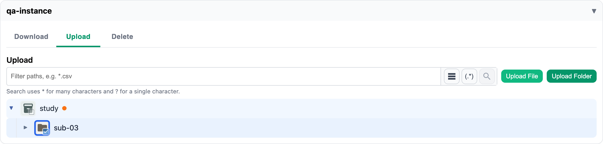

# Uploading files and folders

Open the storage instance's card and choose the **Upload** tab. It shows only the folders you may
upload into.

1. Tick **one** folder: that's where the upload goes.
2. Choose **Upload File** to pick one or more files, or **Upload Folder** to pick a folder from your
   computer. A folder keeps its subfolders.
3. A bar shows how many files are done. When it finishes, the portal says so, and you get a
   [notification](notifications.md).

Your files go straight from your browser to storage; the portal only checks and records them.

## What can stop an upload
<!-- claim: AC-2, AC-3; tests: test_uploading_a_file_never_replaces_an_existing_one, test_a_user_cannot_upload_into_a_folder_they_hold_nothing_in, test_a_file_grant_does_not_allow_replacing_other_files_by_folder_upload, test_a_file_grant_does_not_allow_creating_folders_above_it -->

- **A file with the same name is already there.** Uploads never replace files: the upload stops,
  and nothing in that folder changes. Rename your file, or ask someone who may delete the old one.
- **You may not upload there.** Every file is checked before anything is stored. If any one of
  them is refused, nothing is uploaded.

System files such as `.DS_Store` are skipped when you upload a folder.
